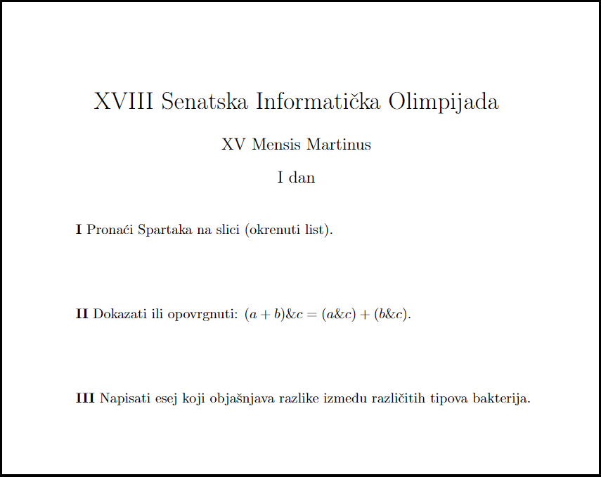
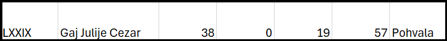

---
hide:
  - toc
---

# 2 - Et tu, Brute?

=== "Zadatak"
	
	| Vremensko ograničenje | Memorijsko ograničenje |
	|:-:|:-:|
	| 1000ms | 256MB |
	
	Gaj Julije Cezar je bio jedan od najuticajnijih i najmoćnijih ljudi u istoriji Rimskog Carstva. Slavu je stekao kao veliki vojskovođa, ali i kao vešt kriptolog i majstor za salate. Međutim, ono što nije poznato je da se gospodin Gaj jako mučio sa matematikom i informatikom. Kada je došlo vreme da učestvuje na XVIII SIO (senatska informatička olimpijada), zvao je svog druga Bruta da ga nauči nekoliko trikova  pred takmičenje. Međutim, svima su bile poznate Julijeve informatičke muke, te su svi zbijali šale na taj račun svakom prilikom. Ali ne bi valjda Brut...
	
	<br>
	
	Brut je odlučio da proda foru Cezaru da važi $(a+b)\text{ and }c=(a\text{ and }c)+(b\text{ and }c)$, gde $\text{and}$ označava bitovsku konjunkciju, a $+$ sabiranje. Da bi ga uverio u ovaj identitet, napisao je dva prirodna broja $N$ i $K$, kao i niz $A$ od $N$ brojeva između $0$ i $2^K-1$. Za svaki par $(i,j)$ sa $i\leq j$, on želi da izabere jedan broj $p_{ij}$ između $0$ i $2^{K+1}-1$ tako da važi $(a_i+a_j)\text{ and } p_{ij}=(a_i\text{ and } p_{ij}) + (a_j\text{ and } p_{ij})$. 
	
	<br>
	
	Vaš zadatak je da odredite, ukoliko se svaki $p_{ij}$ bira međusobno nezavisno, koliko je načina imao Brut da izabere ove brojeve. Kako je moguće da ima mnogo načina da se ovo desi, potrebno je ispisati rešenje po modulu $10^9+7$.
	
	<br>
	
	
	
	## Opisi funkcija
	
	Potrebno je da implementirate funkciju
	
	-   $Cezar(N, K, A[\ldots])$
	
	Ova funkcija će biti pozvana jednom po primeru. Broj $N$  i predstavlja dužinu niza $A$, a $K$ je kao iz teksta. Potrebno je vratiti jedan ceo broj, broj načina po modulu $10^9+7$ da Vrut izabere odgovarajuće brojeve. 
	   **Svi nizovi su indeksirani od 1.**
	
	## Primer
	
	Neka je $N=2$, $K=1$,  $A=\{0,1\}$. Za $p_{11}$ treba videti koji od brojeva od $0$ do $3$ važi da je $(0+0)\text{ and }p_{11}=(0\text{ and }p_{11})+(0\text{ and }p_{11})$, što važi za svaki izbor $p_{11}$ (u svakom slučaju su obe strane $0$). Za $p_{12}$ se isto lako može videti da svaki izbor radi. Za $p_{22}$ možemo izabrati samo $0$ ili $3$, tako da Brut ima ukupno $4\cdot4\cdot2=32$ načina da izabere ove brojeve.
	
	## Ograničenja
	
	-   $1 \leq N \leq 1.000.000$
	-   $1 \leq K \leq 30$
	-   $0 \leq A[i] \leq 2^K-1$
	## Podzadaci
	
	Test primeri su podeljeni u $6$ podzadatka:
	
	-   **[5 poena]:** $A[i]\leq 1$
	-   **[7 poena]:** $K=3$
	-   **[11 poena]:** $K\leq 8$
	-   **[28 poena]:** $N\leq 1.000$
	-   **[27 poena]:** $N\leq 100.000$
	-   **[22 poena]:** Nema dodatnih ograničennja
	
	## Detalji implementacije
	
	Potrebno je da pošaljete tačno jedan fajl  `et_tu_brute.cpp`  koji implementira pomenute funkcije. Osim traženih funkcija, vaš fajl može sadržati i dodatne globalne promenljive, pomoćne funkcije i dodatne biblioteke.
	
	Vaša funkcija mora biti sledećeg oblika:
	
	`int Cezar(int N, int K, int* A);`
	
	**Vašim programima je dozvoljeno da menjaju sadržaj nizova ali ne smeju da pristupaju van granica datih nizova.**
	
	Uz zadatak, obezbeđen vam je "template" fajl  `code.cpp`  koji možete koristiti i menjati po potrebi. Takođe vam je obezbeđen program  `grader.cpp`  koji služi da lakše testirate kodove. Ovaj program učitava sa standardnog ulaza sledeće podatke:
	
	-   U prvom redu brojevi $N$ i $K$.
	-   U narednom redu $N$ brojeva: $A[i]$.
	
	Zatim ovaj program zove vašu funkciju i ispisuje rezultat koji vaša funkcija vrati.
	
	## Napomena
	
	Operator bitovske konjunkcije u C++ zapisujemo pomoću simbola  `&`. Ova operacija $x\ \text{ and } \ y$ se za nenegativne cele brojeve $x,y$ definiše na sledeći način. Prvo se brojevi zapišu u binarnom zapisu. Ukoliko jedan broj ima manje cifara od drugog, dopisuju mu se vodeće nule sve dok ne budu imali isti broj binarnih cifara. Tako se dobijaju dva niza binarnih cifara, označimo ih sa $a_1, \ldots, a_k$ i $b_1, \ldots b_k$. Zatim se za svaku poziciju $i \in {1, \ldots, k }$ računa $c_i$ pomoću sledećih pravila:
	
	-   Za $a_{i} = 0, b_{i} = 0$ važi $c_{i} = 0$
	-   Za $a_{i} = 0, b_{i} = 1$ važi $c_{i} = 0$
	-   Za $a_{i} = 1, b_{i} = 0$ važi $c_{i} = 0$
	-   Za $a_{i} = 1, b_{i} = 1$ važi $c_{i} = 1$
	
	Niz binarnih cifara $c_1, \ldots, c_k$ (koji možda ima vodeće nule) je binarni zapis rezultata, odnosno broja $x \ \text{xor} \ y$.
	
	<br>
	
	Ukoliko vas interesuju zadaci sa XVIII SIO:
	
	<p style="text-align: center;">


	


	</p>
	
	Rezultat koji je Gaj Julije Cezar ostvario na istom
	 
	 <p style="text-align: center;">
	 


	


	
	</p>
	
=== "Rešenje"
	
	| Autor | Tekst i test primeri | Analiza rеšenja | Testiranje |
	|:-:|:-:|:-:|:-:|
	| Pavle Martinović | Pavle Martinović | Pavle Martinović | Aleksa Milisavljević |
	
	## Rešenje kada $A[i]\leq 1$
	Označimo sa $P(i,j)$ broj vrednosti manjih $k$ od $2^{K+1}$ takvih da je $(i+j)\&k=(i\&k)+(j\&k)$. Lako možemo videti da je $P(0,0)=P(0,1)=2^{K+1}$, dok se takođe relativno lako vidi da je $P(1,1)=2^K$ (samo prvi i drugi bit utiču na rešenje, i oni moraju ili oba biti aktivna ili oba neaktivna). Tako da nam je dovoljno da samo nađemo broj nula $c_0$ i broj jedinica $c_1$ i zatim brzim stepenovanjem nađemo $2^{\frac{c_0(c_0+1)}{2}(K+1)+c_0c_1(K+1)+\frac{c_1(c_1+1)}{2}K}$. Složenost $O(N)$.
	## Rešenje kada je $K=3$
	
	Ovde imamo samo $36$ mogućnosti za $P(i,j)$ koje je moguće ili naći ručno na papiru ili programom. Zatim na sličan način kao gore, brzim stepenovanjem i nizom koji predstavlja broj pojavljivanja svakog broja nalazimo rešenje. Složenost $O(N)$.
	
	## Rešenje kada je $K\leq 8$
	U ovom podzadatku postupamo slično kao u prethodnom, samo $P(i,j)$ nalazimo algoritamski tako što testiramo svako $k$. Zatim opet rešenje nalazimo kao proizvod $P(i,j)^{c_ic_j}$ i $P(i,i)^{\frac{c_i(c_i+1)}{2}}$, što možemo naći brzim stepenovanjem. Rešenje $O(N+K^3+K^2\log N)$.
	
	## Rešenje kada je $N\leq 1.000$
	
	Sada nam je potreban brži način za računanje $P(x,y)$. Zapišimo $x$, $y$ i $x+y$ u binarnom zapisu dužine $K+1$ sa vodećim nulama. Neka su to $a_{K+1}a_K\ldots a_1$, $b_{K+1}b_K\ldots b_1$,  i $c_{K+1}c_K\ldots c_1$ i posmatrajmo jednačinu $0=(x\&k)+(y\&k)-((x+y)\&k)$. Ako je $k_{K+1}k_{K}\ldots k_1$ binarni zapis broja $k$ vrednost leve strane jedinačine bi bila suma $v_i=k_i(a_i+b_i-c_i)\cdot 2^i$, a vrednost $a_i+b_i-c_i$ je u skupu $\{-1,0,1,2\}$. Posmatrajmo najveće $i$ tako da je $v_i\neq 0$. Ukoliko je $v_i>0$ znamo da je $v_i\ge 2^i$ i $v_j\ge-2^j$ za $j\leq i$, te je suma $v_i$ pozitivna što nije moguće. Stoga je $v_i=-2^i$. Ovo je jedino moguće ukoliko postoji prenos na poziciji $i-1$ i $a_i=b_i=0$. Dalje $k_{i-1}\cdot(a_{i-1}+b_{i-1}-c_{i-1}),k_{i-2}\cdot(a_{i-2}+b_{i-2}-c_{i-2}),\ldots$ moraju biti (do neke pozicije) $1,1,1,1,1\ldots,2$. Možemo induktivno dokazati da ako su do sad bile jedinice, sledeća cifra je ili $1$ ili $2$ (ako bi bila $0$ ili $-1$ onda zbog veličine, slično prethodnom razmatranju, $k$ ne bi bilo rešenje). Ukoliko je $1$ nastavimo indukciju, ukoliko je $2$ vidimo da ovaj ceo blok ima veličinu $0$ te možemo da ga izbacimo i razmatramo manje skupove. Sada smo dobili vrednosti $v_i$ u nekom bloku $k$ gde svi $k_i$ moraju biti $1$, pa hajde da razmotrimo kako to mora da izgleda za te bitove za $x,y$. Neka je $p_{K+1}p_{K}\ldots p_1$ niz prenosa. Lako se može videti (indukcijom, na primer) da ako je gornji blok od $i$ do $j$ onda mora da važi da je $p_i=p_{i-1}=p_{i-2}=\ldots=p_{j+1}=1$ i $p_j=0$. Već smo videli da pošto je $v_i$ negativan, mora da je $a_i=b_i=0$ i $p_i=1$ tako da je i $p_{i+1}=0$. Tako da blok kečeva uzetih u binarnom zapisu od $k$ mora počinjati od nekog mesta gde nema prenos i ići do sledećeg mesta gde nema prenos. Iz prethodnog se može zaključiti da ukoliko podelimo niz $p$ na blokove oblika $1111\ldots110$, ako uzmemo jedan element iz tog bloka moramo da uzmemo ceo blok, a lako se može videti da je suma u svako  bloku  $0$, bez obzira da li smo uzeli sve nule ili sve jedinice. Stoga je $P(i,j)=2^{\text{broj takvih blokova}}$, odnosno $P(i,j)=2^{\text{broj pozicija u gde nema prenos}}$, tako da ga možemo lako izračunati za svaki par i pomnožiti. Složenost $O(N^2K)$.
	## Rešenje kada je $N\leq 100.000$
	Ukoliko je $A$ odgovor koji tražimo, primetimo da je $\log_2(A)$ broj trojki $(i,j,k)$ tako da $a_i+a_j$ nema prenos na pozciji $k$. Ako fiksiramo $k$, da bismo našli broj parova koji nemaju prenos na toj poziciji, možemo da uzmemo niz po modulu $2^k$ (i dobijemo niz $b_i$) i onda nam treba broj parova tako da je $b_i+b_j<2^k$, što se može uraditi sortiranjem i binarnom pretragom. Zatim samo nađemo rešenje brzim stepenovanjem. Složenost $O(NK\log N)$.
	
	## Glavno rešenje
	U prethodnom rešenju, faktor $\log N$ u rešenju dolazi iz dve stvari: sortiranja i binarne pretrage. Pošto je niz sortiran, binarnu pretragu možemo lako zameniti tehnikom dva pokazivača da bi radilo u $O(N)$ u svakoj od $K$ iteracija. Sortiranje svakako zahteva $N\log N$ vremena, ali je trik da sledeći sortiran niz možemo dobiti od prethodnog. Zaista, u prelazu $k\rightarrow k+1$ svaki $b_i$ ili ostane isti ili ili se poveća za $2^k$. Svi koji su se povećali postaju veći od svih koji nisu, a ostalima parovima relativni poredak ostaje isti. Stoga ako u svakom trenutku pamtimo i od kog elementa je neki $b_i$ "potekao" lako možemo izračunati novi niz, i koristiti to što nam je trenutni već sortiran da bismo sortirali novi u linearnom vremenu (prođemo kroz niz dvaput i prvi put izdvojimo one koje se nisu povećali a u drugom one koji jesu). Ovo je u suštini algoritam sortiranja "radix-sort". Složenost $O(NK)$. 
	
	``` cpp title="02_et_tu_brute.cpp" linenums="1"
	#include <bits/stdc++.h>
	#define MOD 1000000007
	#define MAXN 1000007
	using namespace std;
	pair<int,int> v[MAXN],u[MAXN];
	long long fastpow(long long exp, long long base)
	{
	    if(exp==0) return 1;
	    if(exp&1) return (fastpow(exp-1,base)*base)%MOD;
	    return fastpow(exp/2,(base*base)%MOD);
	}
	int Cezar(int N,int K,int* A)
	{
	    for(int i=1;i<=N;i++) v[i]={0,i};
	    long long cnt=0;
	    for(int j=0;j<K;j++)
	    {
	        int t=1,t1=1,t2=N;
	        for(int i=1;i<=N;i++) u[i]=v[i];
	        for(int i=1;i<=N;i++) if(!(A[u[i].second]&(1<<j))) v[t++]={(A[u[i].second]&(1<<j))+u[i].first,u[i].second};
	        for(int i=1;i<=N;i++) if(A[u[i].second]&(1<<j)) v[t++]={(A[u[i].second]&(1<<j))+u[i].first,u[i].second};
	        while(t1<=t2)
	        {
	            while(t2>=1 && v[t1].first+v[t2].first>=(1<<(j+1))) t2--;
	            if(t2<t1) break;
	            cnt+=t2-t1+1;
	            t1++;
	        }
	    }
	    cnt+=(N+1LL)*N/2LL;
	    return fastpow(cnt,2);
	}

	```
