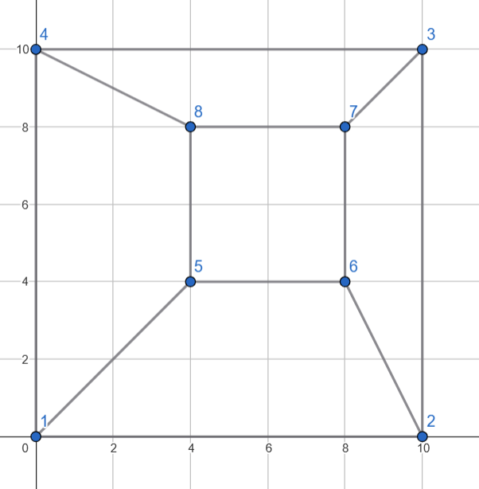
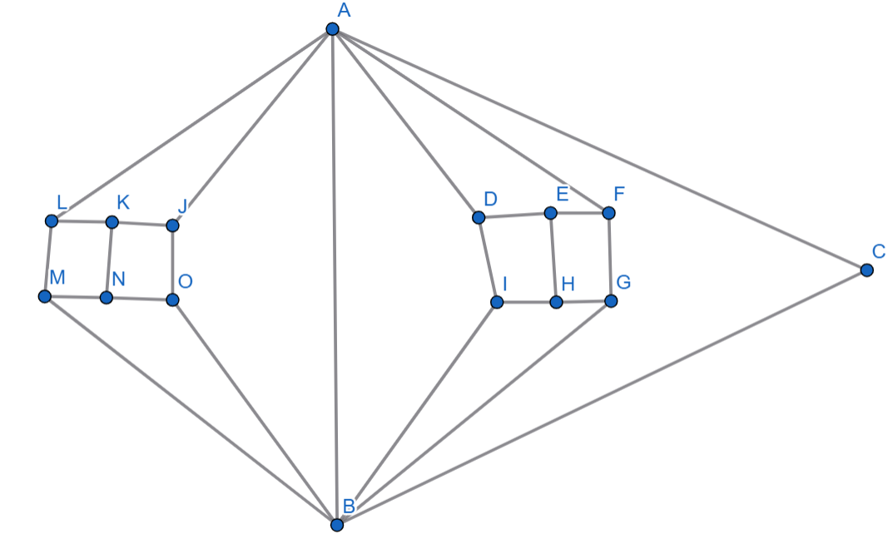

---
hide:
  - toc
---

# 2 - Mesi

=== "Zadatak"
	
	| Vremensko ograničenje | Memorijsko ograničenje |
	|:-:|:-:|
	| 500ms | 128MB |
	
	<br>
	
	Najbolji fudbaler svih vremena, Lionel Mesi, našao se u sličnoj situaciji kao Moša Marjanović. Dostigao je zasićenje od fudbala, jer je osvojio sve što je bilo u ponudi. Poučen iskustvom koje je imao Moša, odlučio je da igra fudbal s decom u selu Jotala.
	
	<br>
	
	U tom selu, deca su jako zagrižena za fudbal, pa imaju postavljene čunjeve na terenu, koji možemo da zamislimo kao ravan. Za svaki od $n$ čunjeva poznate su koordinate $x_i$ i $y_i$ na kojima se nalaze. Dodatno, finansijska situacija u Jotali nije na zavidnom nivou, tako da je teren skoro pa uništen. Postoji  $m$ koridora po kojima može da se Mesi kreće i svaki od njih povezuje tačno dva čunja. Koridori su prave linije i **nikoja dva koridora se ne seku**.
	
	Dodatno, svaki čunj je direktno **povezan sa još bar tri** druga čunja koridorima. 
	
	<br>
	
	Da bi pokazao svoju veštinu, Mesi će krenuti od proizvoljnog čunja i kretaće se po koridorima i obilaziće čunjeve dok se ne vrati u početni. To obično jako usreći decu. Ipak, zbog ogromne nadmorske visine, Mesi ne želi da se suviše umori, pa vas moli da pronađete najkraću putanju koridorima koja kreće od jednog čunja obilazi neke druge čunjeve i vraća se u početni, tako da svaki koridor prođe najviše jednom.
	
	<br>
	
	Na ovaj način Leo će pronaći svoju ljubav prema fudbalu ponovo, a vi vašu prema informatici.
	
	<br>
	
	## Opisi funkcija
	
	<br>
	
	Potrebno je da implementirate funkciju
	
	<br>
	
	- $Mesi(n, m, x[\ldots], y[\ldots], a[\ldots], b[\ldots])$
	
	<br>
	
	**Ova funkcija će biti pozvana $T$ puta po primeru.** Broj $n_i$ predstavlja broj čunjeva, a $m_i$ broj koridora u $i$-tom pozivu funkcije. 
	
	<br>
	
	Niz $x$ predstavlja niz $x$-koordinata čunjeva. Niz $y$ predstavlja niz $y$-koordinata čunjeva.
	
	<br>
	
	Nizovi $a$ i $b$ predstavljaju čunjeve koje koridori povezuju. Preciznije, koridor $i$ povezuje čunjeve $a[i]$ i $b[i]$ . Garantuje se da se nikoja dva koridora ne seku.
	
	<br>
	
	Potrebno je vratiti jedan ceo broj, najkraću putanju koridorima koja kreće i završava se u istom čunju. 
	
	<br>
	
	**Svi nizovi su indeksirani od 1.**
	
	<br>
	
	## Primer
	
	<br>
	
	Neka je:
	- $n=8$, $m=12$
	- $x=\{0, 10, 10, 0, 4, 8, 8, 4\}$
	- $y=\{0, 0, 10, 10, 4, 4, 8, 8\}$
	- $a=\{1, 2, 3, 4, 5, 6, 7, 8, 1, 2, 3, 4\}$
	- $b=\{2, 3, 4, 1, 6, 7, 8, 5, 5, 6, 7, 8\}$.
	
	<br>
	
	Pre svega pogledajmo vizuelnu reprezentaciju terena sa čunjevima i koridorima:
	
	
	
	<br>
	
	Najkraća tražena putanja je dužine 4 i imamo više takvih. Na primer: $1\rightarrow 2\rightarrow 3 \rightarrow 4 \rightarrow 1$ ili $1\rightarrow 2\rightarrow 6 \rightarrow 5 \rightarrow 1$ itd.
	
	<br>
	
	Potrebno je, dakle, vratiti 4.
	
	<br>
	
	
	
	## Ograničenja
	
	<br>
	
	* $4 \leq \sum_{j=1}^T n_j  \leq 100.000$
	* $0 \leq m_j \leq 300.000$
	* $0 \leq x[i] \leq 10^9$, za $i = 1, 2, \ldots, n$
	* $0 \leq y[i] \leq 10^9$, za $i = 1, 2, \ldots, n$
	* $1 \leq a[i] \leq n$, za $i = 1, 2, \ldots, n$
	* $1 \leq b[i] \leq n$, za $i = 1, 2, \ldots, n$
	
	<br>
	
	## Podzadaci
	
	<br>
	
	Test primeri su podeljeni u $8$ podzadatka:
	
	<br>
	
	-   **[2 poena]:** $\sum_{j=1}^T n_j \leq 10$
	-   **[3 poena]:** $\sum_{j=1}^T n_j  \leq 20$
	-   **[10 poena]:** $\sum_{j=1}^T n_j  \leq 100$
	-   **[10 poena]:** Rešenje je neparan broj
	-   **[15 poena]:** $\sum_{j=1}^T n_j  \leq 5000$
	-   **[20 poena]:** Svaki čunj je direktno povezan sa najviše još pet drugih čunjeva koridorima
	-   **[15 poena]:** Postoje barem dva čunja između kojih najkraći put ima barem $25$ koridora 
	-   **[25 poena]:** Nema dodatnih ograničennja
	
	<br>
	
	
	## Detalji implementacije
	
	<br>
	
	Potrebno je da pošaljete tačno jedan fajl  `mesi.cpp`  koji implementira pomenute funkcije. Osim traženih funkcija, vaš fajl može sadržati i dodatne globalne promenljive, pomoćne funkcije i dodatne biblioteke.
	
	<br>
	
	Vaša funkcija mora biti sledećeg oblika:
	
	<br>
	
	`int Mesi(int n, int m, int* x, int* y, int* a, int* b);`
	
	<br>
	
	**Vašim programima je dozvoljeno da menjaju sadržaj nizova ali ne smeju da pristupaju van granica datih nizova.**
	
	<br>
	
	Uz zadatak, obezbeđen vam je "template" fajl  `code.cpp`  koji možete koristiti i menjati po potrebi. Takođe vam je obezbeđen program  `grader.cpp`  koji služi da lakše testirate kodove. Ovaj program učitava sa standardnog ulaza sledeće podatke:
	
	<br>
	
	- U prvom redu brojevi $n$ i $m$.
	- U narednih $n$ redova po dva broja $x[i]$ i $y[i]$.
	- U narednih $m$ redova po dva broja $a[i]$ i $b[i]$.
	
	<br>
	
	Zatim ovaj program zove vašu funkciju i ispisuje rezultat koji vaša funkcija vrati.
	
=== "Rešenje"
	
	| Autor | Tekst i test primeri | Analiza rešenja | Testiranje |
	|:-:|:-:|:-:|:-:|
	| Marko Milenković | Marko Milenković | Marko Milenković | Dragan Urošević |
	
	### Napomena
	
	Data struktura u zadatku je planaran graf sa najmanjim stepenom čvora $3$. Za planarne grafove važi Ojlerova formula i na osnovu nje se može dokazati da u ovakvom grafu da je najmanji ciklus dužine najviše pet. Dakle opcije su $3$, $4$ ili $5$ kao odgovor. Glavna ideja je da tražimo cikluse dužine tri i četiri i ukoliko ih nema, odgovor je pet.
	
	
	### Netačno rešenje
	
	Vredi pomenuti da razmatranje samo lica grafa nije dovoljno. Primer grafa takvog grafa:
	
	
	
	###  $n <= 10$
	
	U ovom podzadatku je dovoljno da probamo sve permutacije čvorova i vidimo da li postoje grane između njih.
	
	###  $n <= 20$
	
	U ovom podzadatku možemo da probamo svih $2^n$ opcija za ciklus.
	
	### $n <= 100$
	
	U ovom podzadatku možemo da brut forsom pretražimo sve cikluse dužine tri ili četiri. Kako je graf redak, i ima najviše $3n$ grana, dovoljno je odraditi najprostiju varijantu.
	
	### Rešenje je neparan broj
	
	U ovom podzadatku je dovoljno da proverimo da li postoji ciklus dužine tri. Možemo to uraditi tako što za svaka dva susedna čvora uporedimo da li imaju zajedničkog suseda. Ukoliko rešenje nije tri, onda mora biti pet.
	
	### $n <= 5000$
	
	Testiranje za postojanje ciklusa dužine tri radimo kao i ranije. Sličnom metodom možemo videti da li postoji ciklus dužine četiri. Za svake dve uzastopne grane (ovakvih nema mnogo, jer je graf planaran) proverimo da li imaju zajednički susedan čvor.
	
	### Stepen svakog čvora u grafu je najviše $5$
	
	Ovo rešenje je jako slično kao za potpun zadatak (videti dole). Jedina razlika je što za ovaj podzadatak ne moramo da uočimo da postoji bar jedan čvor stepena najviše pet.
	
	### Postoje barem dva čunja između kojih najkraći put ima barem $25$ koridora
	
	U ovom podzadatku je moguće primeniti small-to-large tehniku prilikom brojanja ciklusa dužine tri i četiri.
	
	### Bez dodatnih ograničenja
	
	Radi lakšeg traženja želimo da usmerimo grane tako da usmereni graf na kraju bude bez usmerenih ciklusa, a da svaki čvor ima izlazni stepen najviše pet. Iz Ojlerove formule možemo lako videti da uvek postoji čvor stepena najviše pet. Ponavljamo sledeći proces dok ne obiđemo sve čvorove iz grafa.
	
	1. Uočimo čvor stepena najviše pet
	2. Usmerimo sve grane susedne tom čvoru ka van
	3. Obrišemo uočeni čvor i njemu susedne grane
	
	Možemo se uveriti da graf koji pravimo na ovaj način zadovoljava uslove.
	
	Cikluse dužine tri već znamo kako da nađemo iz ranijih podzadataka. Za svaki ciklus dužine četiri postoje tri konfiguracije u kojima može da se nađe:
	
	1. Ukoliko idemo po ciklusu grane su redom: u pravom smeru, u pravom smeru, u pogrešnom smeru, u pogrešnom smeru
	
	2. Ukoliko idemo po ciklusu grane su redom: u pravom smeru, u pravom smeru, u pogrešnom smeru, u pravom smeru
	
	3. Ukoliko idemo po ciklusu grane su redom: u pravom smeru, u pogrešnom smeru, u pravom smeru, u pogrešnom smeru
	
	Prva dva slučaja možemo da rešimo ograničenom potragom u širinu u linearnom vremenu. Za treći slučaj možemo memorisati sve parove grana koje izlaze iz čvora. Među svima njima tražimo da li postoje dva para sa istim krajevima. Vremenska složenost ovde je, zbog toga što planarni graf nema mnogo grana, $\mathcal{O}(n\log n)$.
	
	``` cpp title="02_mesi.cpp" linenums="1"
	#include <bits/stdc++.h>
	
	using namespace std;
	
	int Mesi(int n, int m, int x[], int y[], int a[], int b[]);
	
	int main()
	{
	
	    int test;
	    cin >> test;
	
	    while(test--){
	        int n, m;
	        cin >> n >> m;
	        int* x = new int[n+1];
	        int* y = new int[n+1];
	
	        int* a = new int[m+1];
	        int* b = new int[m+1];
	
	        for (int i=1; i<=n; i++){
	            cin >> x[i] >> y[i];
	        }
	
	
	        for (int i=1; i<=m; i++){
	            cin >> a[i] >> b[i];
	        }
	
	
	        cout << Mesi(n,m,x,y,a,b) << '\n';
	
	        delete[] x;
	        delete[] y;
	        delete[] a;
	        delete[] b;
	    }
	}

	```
