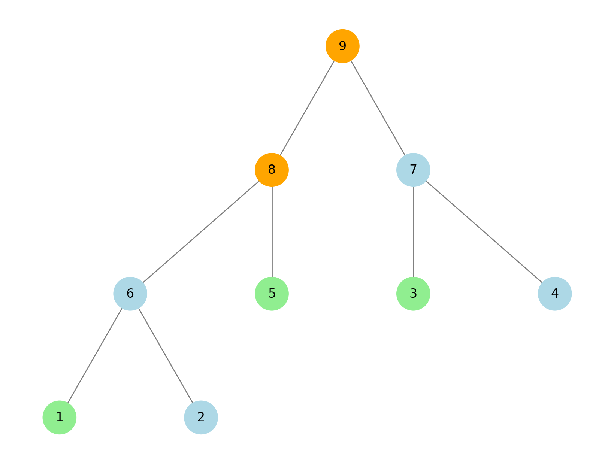

---
hide:
  - toc
---

# 4 - Nalbandian

=== "Zadatak"
	
	| Vremensko ograničenje | Memorijsko ograničenje |
	|:-:|:-:|
	| 3000ms | 256MB |
	
	Tekst zadatka nije dostupan u izvornom direktorijumu.
	
=== "Rešenje"
	
	| Autor | Tekst i test primeri | Analiza rešenja | Testiranje |
	|:-:|:-:|:-:|:-:|
	| Pavle Martinović | Nemanja Majski | Mladen Puzić | Pavle Martinović |
	
	Pre svega, potrebno je da adekvatno zamislimo ovaj turnir. Primetimo da struktura turnira predstavlja ukorenjeno binarno stablo sa $2N-1$ čvorova. Takmičari su u čvorovima indeksiranim brojevima od $1$ do $N$, a mečevi u čvorevima indeksiranim brojevima od $N+1$ do $2N-1$. Deca čvora $N+i$ su čvorovi $A_i$ i $B_i$. Čvorovi takmičara su listovi, pa nemaju decu. Koren ovog stabla je $2N-1$.
	
	Proces turnira možemo zamisliti tako da se pobednik iz svog čvora premesti u roditelja, dok gubitnik ostaje na svom mestu.
	
	## Prvi podzadatak
	Za svaki upit možemo probati sve takmičare $x$ koji se ne nalaze u skupu takmičara datom u upitu. Za takmičara $x$ je optimalno da pobedi sve svoje mečeve. Za takmičare iz skupa, optimalno je da pobede sve svoje mečeve, sem ako se takmiče protiv takmičara $x$. Ukoliko u meču učestvuju dva takmičara koji nisu $x$, niti su iz skupa, nije nam bitno ko pobeđuje.
	
	Ukoliko se prilikom ovog procesa susretnu dva takmičara iz datog skupa, $x$ nije validan kandidat da ih sve pobedi, u suprotnom smo našli kandidata i uvećavamo odgovor za $1$.
	
	**Vremenska složenost:** $O(QN^2 + \sum K_i)$
	**Memorijska složenost:** $O(N)$
	
	## Drugi podzadatak
	U prethodnom podzadatku simuliramo dosta istih stvari bez obzira na to koji $x$ odaberemo. Pokušajmo da to izbegnemo kako bismo ubrzali upute.
	
	Nađimo način da proverimo da li je $x$ validan kandidat, bez da simuliramo proces turnira. Označimo sa $s_p$ broj takmičara iz upita koji se na početku nalaze u podstablu čvora $p$. 
	
	Krenimo od korena stabla. Neka su njegova deca čvorovi $p$ i $q$:
	- ukoliko $s_p \geq 2$ i $s_q \geq 2$, onda koje god $x$ odaberemo, neka dva takmičara iz skupa će se susresti u podstablu u kojem nije $x$ - dakle, odgovor je $0$
	- ukoliko $s_p \leq 1$ i $s_q \leq 1$, svi kandidati u oba ova podstabla su validni
	- ukoliko $s_p \leq 1$, a $s_q \geq 2$ (analogno je i u suprotnom slučaju), takmičara iz skupa iz podstabla čvora $p$ može da sretne najranije u finalu, dok sve iz podstabla čvora $q$ (ukoliko postoje) mora sresti ranije u turniru. Zato validan kandidat, ukoliko postoji, definitivno se nalazi u podstablu čvora $q$. Premeštamo se u čvor $q$ i odatle rekurzivno ponavljamo ovu analizu slučajeva.
	
	Nastavljamo ovaj proces bilo dok ne dođemo do nekog lista i vratimo odgovor, ili do prvog slučaja, gde kandidat ne postoji.
	
	**Vremenska složenost:** $O(QN + \sum K_i)$
	**Memorijska složenost:** $O(N)$
	
	## Treći podzadatak
	Jedini slučaj koji moramo izbeći jeste da se oba takmičara nalaze u nekom podstablu, a da se naš kandidat $x$ ne nalazi u tom podstablu. U tom slučaju bi se ta dva takmičara srela, pre nego što bi sreli takmičara $x$.
	
	Prvo podstablo u kojem se nalaze oba takmičara zove se *najnižim zajedničkim pretkom* (*lowest common ancestor*) i može se naći u vremenskoj složenosti $O(\log N)$ sa pretprocesiranjem (može i brže, ali nema potrebe). Sva ostala podstabla su pretci *LCA*, tako da je dovoljno da naš kandidat bude u podstablu čvora koji je *LCA* dva čvora iz upita.
	
	Odgovor je, dakle, broj listova u tom podstablu, ne računajući dva čvora iz upita.
	
	**Vremenska složenost:** $O(Q\log N + N)$
	**Memorijska složenost:** $O(N)$
	
	## Četvrti podzadatak
	Slučaj kada $K = 2$ rešavamo isto kao u prethodnom podzadatku. Kada $K = 3$, ponovo ne sme da nam se desi da imamo dva takmičara iz upita koji su u istom podstablu, a da naš kandidat $x$ nije u njemu - jedino što ovaj put imamo ukupno tri takmičara u upitu.
	
	Nađimo *LCA* za sva tri para takmičara. Primetimo da će dva od tri *LCA* biti isti čvor i da će biti predak trećeg *LCA*.
	
	Primer sa $5$ takmičara:
	
	
	*LCA* za $(1, 3)$ i $(5, 3)$ je čvor $9$, koji je predak čvoru $8$ - koji je *LCA* za $(1, 5)$.
	
	Dovoljno je da se $x$ nalazi u podstablu trećeg (najnižeg) *LCA* (u prethodnom primeru čvor $8$) - odgovor možemo izračunati na isti način kao u prethodnom podzadatku.
	
	**Vremenska složenost:** $O(Q\log N + N)$
	**Memorijska složenost:** $O(N)$
	
	## Peti podzadatak
	Dati turnir formira balansirano binarno stablo - za svaki čvor koji nije list i njegovu decu $p$ i $q$, dubine njihovih podstabala se razlikuju za najviše jedan. Dubina ovakvog stabla je $O(\log N)$. 
	
	Možemo primeniti isto rešenje iz drugog podzadatka, samo što više ne možemo da izračunamo unapred sve vrednost $s_p$, jer je $N$ preveliko. 
	
	Možemo naći Ojlerov obilizak stabla (pustiti pretragu po dubini, *DFS*, iz korena, i zapisati čvorove u redu posećivanja) i poređati takmičare iz upita po tom redosledu. Nakon toga $s_p$ možemo naći binarnom pretragom po tom nizu. 
	
	**Vremenska složenost:** $O(Q\log N\sum \log K_i+ \sum K_i \log K_i + N)$
	**Memorijska složenost:** $O(N)$
	
	**Alternativno rešenje:** Ukoliko je $K_i > 20$, odgovor je nula (pošto će svaki takmičar imati manje od $20$ mečeva, ne može pobediti više od $20$ protivnika). U suprotnom primeniti rešenje iz sledećeg podzadatka.
	
	## Šesti podzadatak
	Možemo naći *LCA* za sve parove takmičara iz upita. Ukoliko imamo dva *LCA* tako da nijedan nije predak drugog, odgovor je $0$ - oba podstabla tih *LCA* imaju makar dva takmičara iz upita, a pošto nemaju preseka, naš kandidat se ne može naći u oba. 
	
	U suprotnom, svi *LCA*-ovi su na istom putu od korena do nekog lista. Uzmimo najdublji *LCA* - validni kandidat je svaki takmičar iz ovog podstabla, koji nije u upitu.
	
	**Vremenska složenost:** $O(QK_i^2\log N + N)$
	**Memorijska složenost:** $O(N + K^2)$
	
	## Rešenje za 100 bodova
	U prethodnom podzadatku, dosta *LCA*-ova se pojavljuje više puta. Štaviše, postojaće najviše $K_i-1$ različitih *LCA*-ova ako uzmemo *LCA* svih parova takmičara iz upita (dokaz će slediti iz konstrukcije). Ukoliko uspemo da efikasno nađemo ove *LCA*-ove, značajno ćemo ubrzati prethodno rešenje.
	
	Možemo naći Ojlerov obilizak stabla i poređati takmičare iz upita po tom poretku. Dovoljno je posmatrati *LCA*-ove uzastopnih takmičara u takvom poretku, kojih je $K-1$.
	
	**Dokaz:** Posmatrajmo neka dva neuzastopna takmičara u prethodnom poretku $p$ i $q$ (recimo da je $p$ pre $q$ u poretku), kao i njihov *LCA* $x$. Pošto je $x$ *LCA* ova dva čvora, oni se nalaze u različitim podstablima njegove dece. Takođe, pošto su $p$ i $q$ neuzastopni u Ojlerovom poretku, to znači da postoji čvor $t$ koji je u istom podstablu kao jedan od ta dva čvora. Bez umanjenja opštosti, recimo da je u pitanju čvor $p$ - to znači da je *LCA* od $(t, q)$ takođe $x$:
	- ukoliko su $t$ i $q$ susedni u Ojlerovom poretku, dokazali smo da se $x$ može i tako naći
	- ukoliko nisu, ponavljamo proces za $t$ i $q$, dok ne dođemo do susednih takmičara. Proces će se eventualno završiti jer su $t$ i $q$ definitivno bliži u poretku nego $p$ i $q$.
	
	Ako ih tražimo tim redom, biće sortirani po Ojlerovom poretku, pa možemo jednostavno proveriti da li se svi nalaze na istom putu od korena koristeći vreme ulaska i izlaska u čvorove (dobijene prilikom *DFS*), kao i naći najdublji kako bismo našli rešenje ukoliko postoji.
	
	**Vremenska složenost:** $O(\sum K_i (\log K_i + \log N) + Q + N)$
	**Memorijska složenost:** $O(N)$
