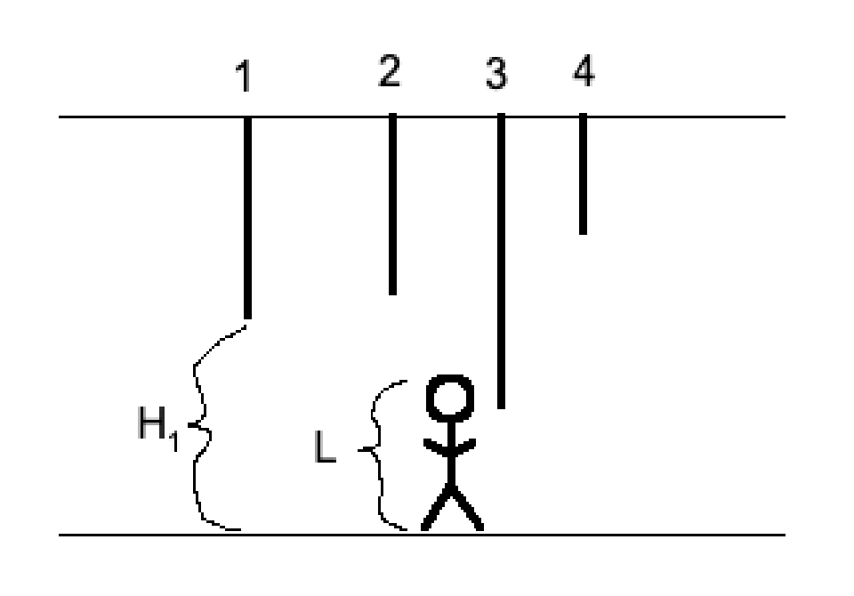

---
hide:
  - toc
---

# 1 - Pećina

=== "Zadatak"
	
	| Vremensko ograničenje | Memorijsko ograničenje |
	|:-:|:-:|
	| 200ms | 64MB |
	
	<br>
	
	Mladi programer Perica jednog sunčanog dana je naišao na pećinu. Perica kao znatiželjni dečak krenuo je u istragu te pećine. Kada je ušao otkrio je da se tu nalazi tačno $N$ stalaktita, koji su indeksirani od $1$ do $N$ redom. Poznato je da se $i$-ti stalaktit nalazi na visini $H_i$ u odnosu na zemlju. Poslednji put kada je Perica merio svoju visinu, ona je iznosila tačno $L$. 
	
	<br>
	
	Perica je ušao u pećinu i hodao dok nije naišao na stalaktit koji ne može da zaobiđe. Preciznije, on može da prođe pored stalaktita ukoliko se najniži deo stalaktita nalazi iznad njega. 
	
	<br>
	
	Vaš zadatak je da pomognete Perici i da odredite redni broj, odnosno indeks stalaktita gde bi se on zaustavio. Ukoliko Perica može da prođe kroz celu pećinu, onda je potrebno ispisati `-1`.
	
	<br>
	Na slici ispod je prikazan prvi primer:
	
	<br>
	
	  
	
	<br>
	
	## Opis ulaza
	
	<br>
	
	U prvom redu standardnog ulaza, nalaze se dva prirodna broja $N$ i $L$, koji predstavljaju broj stalaktita i Peričinu visinu, respektivno. U drugom i poslednjem redu standardnog ulaza se nalaze $N$ prirodnih brojeva, gde $i$-ti broj predstavlja $H_i$ - visinu $i$-tog stalaktita.
	
	<br>
	
	## Opis izlaza
	
	<br>
	
	U prvoj i jedinoj liniji standardnog izlaza ispisati redni broj, odnosno indeks traženog stalaktita, ili $-1$ ukoliko on ne postoji.
	
	<br>
	
	## Primer 1
	
	<br>
	
	### Ulaz
	
	<br>
	
	```
	4 5
	7 8 4 10
	```
	
	<br>
	
	### Izlaz
	
	<br>
	
	```
	3
	```
	
	<br>
	
	### Objašnjenje
	
	<br>
	
	Sa slike u tekstu zadatka se vidi da Perica stiže do trećeg stalaktita, pa je u ovom primeru potrebno ispisati $3$.
	
	<br>
	
	## Primer 2
	
	<br>
	
	### Ulaz
	
	<br>
	
	```
	3 6
	10 6 4
	```
	
	<br>
	
	### Izlaz
	
	<br>
	
	```
	2
	```
	
	<br>
	
	### Objašnjenje
	
	<br>
	
	Ukoliko je stalaktit iste visine kao Perica, smatra se da će ga Perica zakačiti, te da ne može da prođe dalje.
	
	<br>
	
	### Primer
	
	<br>
	
	### Ulaz
	
	<br>
	
	```
	4 5
	9 10 6 7
	```
	
	<br>
	
	### Izlaz
	
	<br>
	
	```
	-1
	```
	
	<br>
	
	## Ograničenja
	
	<br>
	
	* $1 \leq N \leq 1\,000$
	
	* $1 \leq L,H_i \leq 10^9$
	
	<br>
	
	Test primeri su podeljeni u četiri disjunktne grupe:
	
	* U testovima vrednim 10 poena: $N = 5$ i $H_1 = H_2 = \ldots = H_n$.
	
	* U testovima vrednim 40 poena: $N = 5$.
	
	* U testovima vrednim 10 poena: garantuje se da će Perica stići ili do poslednjeg stalaktita ili će proći kroz celu pećinu.
	
	* U testovima vrednim 40 poena: bez dodatnih ograničenja.
	
	<br>
	
=== "Rešenje"
	
	| Autor | Tekst i test primeri | Analiza rešenja | Testiranje |
	|:-:|:-:|:-:|:-:|
	| Miloš Milutinović | Miloš Milutinović | Vladimir Milovanović | Vladimir Milovanović |
	
	### Glavno rešenje
	
	Kako bi se rešio zadatak dovoljno je, počevši od prvog, iterirati kroz niz oformljen od vrednosti visina stalaktita (misli se na visinu od poda pećine na kojoj se nalazi vrh stalaktita) i upoređivati visinu $i$-tog stalaktita $H_i$ sa visinom $L$. Ukoliko je $H_i \leq L$ neophodno je ispisati $i$ vodeći računa da indeksi koji zapravo predstavljaju redne brojeve stalaktita počinju od $1$, a ne od $0$. Za slučaj da se prođe kroz čitav niz, to jest svih $N$ vrednosti visina stalaktita, i da su pritom visine svih njih strogo veće od $L$, tada je potrebno ispisati `-1`.
	
	Pošto visine $H_i$ nisu uređene, odnosno sortirane, za rešavanje zadatka neophodno je u najgorem slučaju proći kroz svih $N$ visina stalaktita, pa je vremenska složenost algoritma $\mathcal{O}(N)$, to jest linearna po dužini niza koji sadrži visine stalaktita. Kada bi niz visina bio sortiran, što u ovom zadatku nije slučaj, mogao bi se potencijalno primeniti i neki efikasniji algoritam poput binarne pretrage.
	
	Izvorni kod u programskom jeziku Pajton mogao bi izgledati recimo:
	
	```python
	N, L = map(int,input().split())
	H = list(map(int,input().split()))
	
	idx = -1
	for i in range(len(H)):
	    if H[i] <= L:
	        idx = i + 1
	        break
	
	print(idx)
	```
	
	``` cpp title="01_pecina.cpp" linenums="1"
	#include <bits/stdc++.h>
	
	using namespace std;
	
	int main() {
	  ios::sync_with_stdio(false);
	  cin.tie(0);
	  int n, l;
	  cin >> n >> l;
	  for (int i = 1; i <= n; i++) {
	    int h;
	    cin >> h;
	    if (h <= l) {
	      cout << i << '\n';
	      return 0;
	    }
	  }
	  cout << -1 << '\n';
	  return 0;
	}

	```
