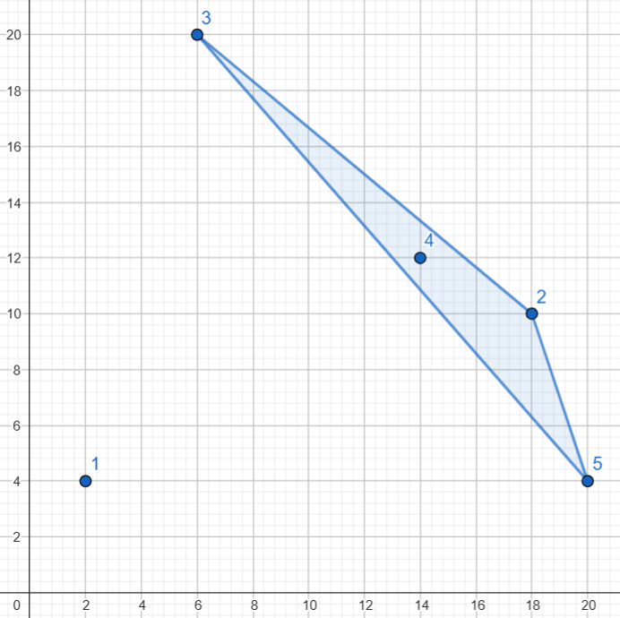
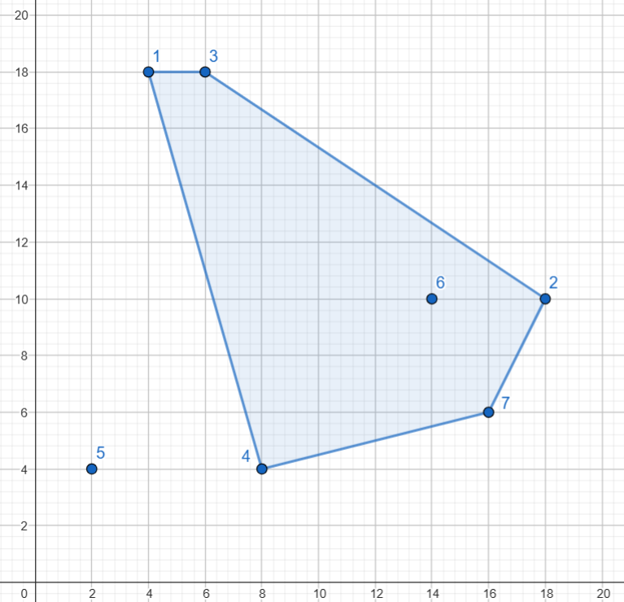
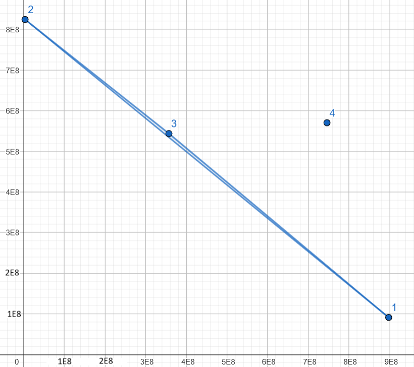

---
hide:
  - toc
---

# 4 - Konveksni skoro omotač

=== "Zadatak"
	
	| Vremensko ograničenje | Memorijsko ograničenje |
	|:-:|:-:|
	| 1500ms | 64MB |
	
	<br>
	
	Andrej je učenik veoma poznate škole. Na poslednjem pismenom iz programiranja je dobio veoma zanimljiv zadatak. Toliko mu se svideo da je odlučio da ga zada svom prijatelju Pavlu.
	<br>
	Andrej je na tabli nacrtao $N$ tačaka u koordinatnoj ravni. Zanimljivo je da ih je nacrtao tako da ne postoje $3$ kolinearne tačke i da sve tačke imaju parne koordinate. Nakon toga je definisao konveksni omotač i konveksni skoro omotač skupa tačaka. 
	
	<br>
	
	Konveksni omotač definišemo kao konveksni mnogougao najmanje površine koji sadrži **svih** $N$ tačaka. Tačke mogu biti na ivici, ili u unutrašnjosti mnogougla.
	
	<br>
	
	Konveksni skoro-omotač definišemo kao konveksni mnogougao najmanje površine koji sadrži **barem** $N-1$ datih tačaka, ali ne nužno sve. Tačke mogu biti na ivici, ili u unutrašnjosti mnogougla.
	
	<br>
	
	Pavlov zadatak? Pavle treba da nacrta **konveksni skoro-omotač** datog skupa tačaka. Pomozite Pavlu tako što ćete mu reći njegovu površinu.
	
	<br>
	
	## Opis ulaza
	
	<br>
	
	U prvoj liniji standardnog ulaza dat je broj $N$ - broj tačaka u ravni.
	
	<br>
	
	U $i$-toj od sledećih $N$ linija nalaze se brojevi $x_i$ i $y_i$ - koordinate $i$-te tačke. 
	
	<br>
	
	Garantuje se da su sve koordinate tačaka parni brojevi i da ne postoje $3$ kolinearne tačke.
	
	<br>
	
	## Opis izlaza
	
	<br>
	
	U jednoj liniji standardnog izlaza ispišite jedan ceo broj - površinu konveksnog skoro-omotača datih tačaka.
	
	<br>
	
	Može da se dokaže iz uslova zadatka da će ta površina uvek biti ceo broj.
	
	<br>
	
	## Primer 1
	
	<br>
	
	### Ulaz
	
	<br>
	
	```
	5
	2 4
	18 10
	6 20
	14 12
	20 4
	```
	
	<br>
	
	### Izlaz
	
	<br>
	
	```
	26
	```
	
	### Objašnjenje
	
	<br>
	
	Konveksni skoro-omotač je trougao koji se sastoji od tačaka ($18$,$10$), ($6$,$20$) i ($20$,$4$). Njegova površina je $26$.
	<br>
	Tačke kao i konveksni skoro-omotač možete da vidite na slici ispod.
	<br>
	
	<br>
	## Primer 2
	
	<br>
	
	### Ulaz
	
	<br>
	
	```
	7
	4 18
	18 10
	6 18
	8 4
	2 4
	14 10
	16 6
	```
	
	<br>
	
	### Izlaz
	
	<br>
	
	```
	104
	```
	
	### Objašnjenje
	
	<br>
	Konveksni skoro-omotač je petougao koji se sastoji od tačaka ($4$,$18$), ($6$,$18$), ($18$,$10$), ($16$,$6$) i ($8$,$4$). Njegova površina je $104$.
	<br>
	Tačke kao i konveksni skoro-omotač možete da vidite na slici ispod.
	<br>
	
	
	
	<br>
	
	## Primer 3
	
	<br>
	
	### Ulaz
	
	<br>
	
	```
	4
	897759290 91195278
	3106330 824428456
	356965620 543776038
	745791392 570501492
	```
	
	<br>
	
	### Izlaz
	
	<br>
	
	```
	4187427638333170
	```
	
	### Objašnjenje
	
	<br>
	
	Konveksni skoro-omotač je trougao koji se sastoji od tačaka
	($897759290$, $91195278$), ($3106330$, $824428456$) i ($356965620$, $543776038$), odnosno, prve $3$ tačke na ulazu. Njegova površina je $4187427638333170$.
	<br>
	Tačke kao i konveksni skoro-omotač možete da vidite na slici ispod.
	<br>
	
	<br>
	## Ograničenja
	
	
	<br>
	
	
	- $4 \le N \le 10^5$ 
	
	- $2 \le x_i,y_i \le 10^9$, za $1 \le i \le N$
	
	- $(x_i, y_i) \neq (x_j, y_j)$, za $1 \le i < j \le N$
	
	- $x_i$ i $y_i$ su parni, za $1 \le i \le N$
	
	- Ne postoje $3$ kolinearne tačke.
	
	
	<br>
	
	Test primeri su podeljeni u $7$ disjunktnih grupa:
	
	
	   - U testovima vrednim $8$ poena: važi $N=4$
	   - U testovima vrednim $12$ poena: važi da duži između tačaka $i$ i $i+1$ za $1 \le i < N$ i duž između tačaka $N$ i $1$ su stranice konveksnog $N$-tougla.
	   - U testovima vrednim $8$ poena: važi $N \le 500$
	   - U testovima vrednim $12$ poena: važi $N \le 2000$
	   - U testovima vrednim $12$ poena: važi da konveksni omotač ima **najviše** $10$ stranica.
	   - U testovima vrednim $20$ poena: važi da konveksni omotač ima **najmanje** $N-100$ stranica.
	   -  U testovima vrednim $28$ poena: nema dodatnih ograničenja.
	
	<br>
	
	
	## Napomena
	<br>
	Površina konveksnog skoro-omotača može da bude veoma velika - brojčano skoro $10^{18}$.
	<br>
	
	
	
=== "Rešenje"
	
	| Autor | Tekst i test primeri | Analiza rešenja | Testiranje |
	|:-:|:-:|:-:|:-:|
	| Nemanja Majski | Nemanja Majski | Nemanja Majski | Aleksandar Višnjić |
	
	### Računanje površine:
	Površinu nekog konveksnog mnogougla možemo izračunati tako što ga podelimo na trouglove, izračunamo površine tih trouglova i saberemo ih. Važno je da površinu računamo koristeći samo cele brojeve. Preporuka je da se to radi preko vektorskog proizvoda. Ako se koristi npr. Heronova formula, dešavaju se greške u preciznosti, zbog čega program neće dati tačan rezultat.
	 
	### Rešenje kada je $N=4$:
	Primetimo da je problem isto što i sklanjanje jedne tačke i zatim traženje minimalnog konveksnog omotača ostalih tačaka. Iz toga sledi da će konveksni skoro omotač biti trougao koji ima $3$ od date $4$ tačke. Tako da možemo proveriti sve trouglove i ispisati najmanju od njihovih površina.
	
	### Rešenje kada je $N \le 500$:
	
	Primetimo da kako bismo našli konveksni skoro-omotač možemo da iteriramo kroz tačku koju izbacujemo i da nađemo konveksni omotač ostalih tačaka. Takav omotač sa najmanjom površinom je  konveksni skoro-omotač.
	
	Za nalaženje konveksnog omotača možemo koristiti algoritam u složenosti $O(N^2)$. Na primer `Jarvis march` algoritam.
	
	Vremenska složenost je $O(N^3)$, a memorijska $O(N)$.
	
	### Rešenje kada je $N \le 2000$:
	
	Koristimo rešenje iz prethodnog podzadatka, samo što koristimo efikasniji algoritam za nalaženje konveksnog omotača. Možemo na primer koristiti `Graham scan` koji radi u vremenskoj složenosti $O(N log N)$.
	
	Vremenska složenost je $O(N^2 log N)$, a memorijska $O(N)$.
	
	### Rešenje kada je broj stranica konveksnog omotača najviše 10:
	
	Radimo algoritam iz prethodnog podzadatka. No, primetimo da kada se skloni tačka koja se ne nalazi na ivici konveksnog omotača (odnosno nije njegovo teme), onda njeno sklanjanje ne menja površinu konveksnog omotača ostalih tačaka. Tako da možemo na početku naći konveksni omotač i onda imamo samo $10$ tačaka čije izbacivanje treba da proverimo.
	
	Vremenska složenost je $O(\alpha \cdot N log N)$, a memorijska $O(N)$, gde $\alpha$ predstavlja broj temena konveksnog omotača.
	 
	### Rešenje kada su tačke temena konveksnog $N-$tougla:
	
	Iteriramo po tački koju izbacujemo. Neka je to tačka $A$ i neka su njeni susedi $B$ i $C$. Primetimo da će konveksni omotač biti isti, sem što posle tačke $B$ neće dolaziti tačka $A$ nego tačka $C$. Tako da će njegova površina biti jednaka površini početnog mnogougla umanjenoj  za površinu trougla $ABC$.
	
	Ako izračunamo površinu originalnog mnogougla i oduzmemo površinu najvećeg trougla koji čine $3$ susedne tačke, našli smo površinu konveksnog skoro-omotača. 
	
	Vremenska i memorijska složenost je $O(N)$.
	### Rešenje kada je broj stranica konveksnog omotača najmanje $N - 100$:
	
	Nađimo konveksni omotač svih tačaka. Nad njime primenjujemo algoritam iz prethodnog podzadatka. Problem je ako se u trouglu $ABC$ nalaze neke tačke. 
	
	Tada konveksni omotač neće ići od tačke $B$ do tačke $C$, već će sadržati i neke tačke koje se nalaze u trouglu $ABC$. Da bismo našli za koliko se smanji površina sklanjanjem tačke $A$, moramo od površine trougla $ABC$ oduzeti površinu konveksnog omotača skupa tačaka koji čine tačke $B$, $C$ i tačke unutar trougla $ABC$ (bez tačke $A$). 
	
	Kako je broj tačaka koje se nalaze van konveksnog omotača mali, možemo da prođemo kroz sve i nađemo koje pripadaju trouglu $ABC$. Takođe, pravljenje tih $N$ konveksnih omotača će takođe biti dosta brzo, pošto se svaka tačka nalazi u najviše $2$ takva trougla.
	
	Vremenska složenost je $O(\alpha \cdot N + N log N)$, a memorijska $O(N)$, gde $\alpha$ predstavlja broj tačaka koje se ne nalaze na konveksnom omotaču.
	
	### Glavno rešenje
	
	Ukoliko se jako puno tačaka ne nalazi na konveksnom omotaču, presporo je $O(N)$ puta proveravati svaku da li se nalazi u trouglu. Posebno pošto se uglavnom i ne nalazi. 
	
	Neka su koordinate tačaka trougla $ABC$ redom ($x_1$,$y_1$),($x_2$,$y_2$),($x_3$,$y_3$). Onda da bi neka tačka ($x$, $y$) pripadala trouglu $ABC$, mora da važi:
	
	$$min(x_1, x_2, x_3) \le x \le max(x_1, x_2, x_3)$$
	
	Ako tačke originalno sortiramo po $x$ koordinati, onda je nalaženje svih takvih tačaka lako koristeći binarnu pretragu. Onda za sve takve tačke proverimo da li su u trouglu.
	
	Kako je konveksni omotač konveksan monougao, to znači da ga svaka prava seče u najviše $2$ tačke. Iz toga sledi da će uz optimizajicu gore svaka tačka biti proverena najviše $4$ puta da li je u nekom trouglu, pa će biti najviše $4 \cdot N$ provera.
	
	Vremenska složenost je $O(N log N)$, a memorijska $O(N)$.
	
	``` cpp title="04_konveksni_skoro_omotac.cpp" linenums="1"
	/// Dodaj da nema 3 kolinearne i N>=4
	#include<bits/stdc++.h>
	#define ll long long
	using namespace std;
	const int maxn=2e5+5;
	int N;
	void greska(string a){
	   cerr<<a<<endl;
	   exit(-1);
	}
	int min3(int a,int b,int c){
	   return min(a,min(b,c));
	}
	int max3(int a,int b,int c){
	   return max(a,max(b,c));
	}
	struct tacka{
	   ll x,y;
	   const bool operator == (const tacka &a) const{
	      return x==a.x and y==a.y;
	   }
	}niz[maxn];
	bool cmp(tacka a,tacka b){ /// Sortira tacke po x i y osi
	   if(a.x<b.x)
	      return true;
	   if(a.x>b.x)
	      return false;
	   return a.y<b.y;
	}
	ll orijent(tacka p1,tacka p2,tacka a){ /// Nalazi orijentaciju tacke a u odnosu na pravu p1 - p2
	   tacka v1;
	   v1.x=p2.x-p1.x;
	   v1.y=p2.y-p1.y;
	
	   tacka v2;
	   v2.x=a.x-p1.x;
	   v2.y=a.y-p1.y;
	
	   ll ort=v1.x*v2.y-v1.y*v2.x;
	   if(ort==0)
	      greska("NASAO 3 KOLINEARNE!");
	   if(ort<0)
	      return -1;
	   return 1;
	}
	ll povrsina(tacka x,tacka y,tacka z){ /// Povrsina trougla
	   tacka v1;
	   tacka v2;
	   v1.x=y.x-x.x;
	   v1.y=y.y-x.y;
	   v2.x=z.x-x.x;
	   v2.y=z.y-x.y;
	   return abs(v1.x*v2.y-v2.x*v1.y)/2;
	}
	ll povrsina(vector<tacka> V){ /// Povrsina konveksnog monougla V
	   if(V.size()<=2)
	      return 0;
	   ll ans=0;
	   for(int i=1;i+1<V.size();i++)
	      ans+=povrsina(V[0],V[i],V[i+1]);
	   return ans;
	}
	tacka glavna;
	bool cmp2(tacka a,tacka b){ /// Sortira tacke po orijentaciji u odnosu na glavnu tacku
	   return (a.y-glavna.y)*(b.x-glavna.x)<=(b.y-glavna.y)*(a.x-glavna.x);
	}
	vector<tacka> makehull(vector<tacka> V){ /// Pravi konveksni omotac od V tacaka. Vazno je da je V vec sortiran po x i y
	   if(V.size()<=2)
	      return V;
	   vector<tacka> H; /// H ce biti konveksni omotac, sortiran redom tako da izmedju 2 susedna broja postoji duz
	
	   H.push_back(V[0]); /// Najlevlja tacka je sigurno u omotacu
	   glavna=V[0];
	   sort(V.begin()+1,V.end(),cmp2); /// Sortira ostale tacke po orijentaciji
	
	   for(int i=1;i<V.size();i++){ /// Ubacuje tacke redom
	
	      while(H.size()>=2){ /// Sve dok je monougao nekonveksan, izbaci poslednju tacku
	         tacka koja=H.back();
	         H.pop_back();
	
	         if(orijent(H.back(),koja,V[i])==1){ /// Monougao je konveksan, kraj procesa
	            H.push_back(koja);
	            break;
	         }
	      }
	
	      H.push_back(V[i]);
	   }
	
	   return H;
	}
	bool pripada(tacka a,tacka b,tacka c, tacka x){ /// Da li tacka x pripada trouglu od tacaka a, b, c
	   if(x==a or x==b or x==c) /// Ovo moramo da proverimo da ne bi dao gresku za 3 kolinearne kada je jedna tacka ponovljena
	      return true;
	
	   int o1,o2,o3;
	   o1=orijent(a,b,x);
	   o2=orijent(b,c,x);
	   o3=orijent(c,a,x);
	
	   return o1==o2 and o2==o3;
	}
	int nadji(int x){ /// Binarno trazi najveci indeks tacke kojoj je x koordinata <=x
	   int dg=1,gg=N,ret=0,sred;
	   while(dg<=gg){
	      sred=(dg+gg)/2;
	      if(niz[sred].x<=x){
	         ret=sred;
	         dg=sred+1;
	      }
	      else
	         gg=sred-1;
	   }
	   return ret;
	}
	int main(){
	   /// Unos podataka
	   cin>>N;
	   for(int i=1;i<=N;i++)
	      cin>>niz[i].x>>niz[i].y;
	   /// Sortiranje po x osi
	   sort(niz+1,niz+1+N,cmp);
	
	   /// Hull vektor koji sadrzi konveksni omotac. Vektor A je samo privremeni posto funckija makehull prima vektor kao ulaz.
	   vector<tacka> A,hull;
	   for(int i=1;i<=N;i++)
	      A.push_back(niz[i]);
	   hull=makehull(A);
	   /// Vektor A se ne koristi nakon ove linije
	
	   ll orgp=povrsina(hull); /// Povrsina originalnog omotaca
	   ll res=0; /// Najvece smanjenje povrsine moguce izbacivanjem jedne tacke
	
	   /// Da bi lakse procesirali 'trouglove' omotaca, ponavljamo prve dve tacke. Garantuje se da omotac ima bar 3 tacke iz uslova N>=4
	   hull.push_back(hull[0]);
	   hull.push_back(hull[1]);
	
	   for(int i=1;i+1<hull.size();i++){ ///Iteriramo kroz tacke na omotacu
	      /// Smanjenje povrsine kada se skloni tacka i. To je jednako povrsini trougla - povrsina konveksnog omotaca tacaka ispod njega (ukljucujuci druga dva temena). Inicijalizujemo ga na povrsinu trougla, pa cemo kasnije oduzeti povrsinu konveksnog omotaca.
	      ll smanjenje_povrsine=povrsina(hull[i-1],hull[i],hull[i+1]);
	
	      /// Najmanja i najveca vrednost x u trouglu. Ovo nam treba kako bi nasli tacke koje uopste vredi proveravati da li su u trouglu. Ako bi proveravali sve tacke to bi bilo O(N * velicina_omotaca) i presporo. Na ovaj nacin svaku tacku proverimo najvise 4 puta.
	      int x1=min3(hull[i-1].x,hull[i].x,hull[i+1].x);
	      int x2=max3(hull[i-1].x,hull[i].x,hull[i+1].x);
	
	      /// Nalazimo pocetak i kraja intervala tacaka koje treba da proverimo da li su u trouglu
	      int poc=nadji(x1-1)+1;
	      int kraj=nadji(x2);
	
	
	      vector<tacka> u_trouglu; /// Vektor koji sadrzi sve tacke koje pripadaju trouglu koji je sklonjen
	      for(int j=poc;j<=kraj;j++){
	         if(niz[j]==hull[i]) /// Preskacemo tacku koju smo sklonili
	            continue;
	         if(!pripada(hull[i-1],hull[i],hull[i+1],niz[j]))
	            continue;
	         u_trouglu.push_back(niz[j]);
	      }
	
	      /// Ako ima neka tacka u trouglu sem druga dva temena, oduzimamo povrsinu
	      if(u_trouglu.size()>2)
	         smanjenje_povrsine-=povrsina(makehull(u_trouglu));
	
	      res=max(res,smanjenje_povrsine);
	   }
	   cout<<orgp-res<<"\n";
	   return 0;
	}

	```
