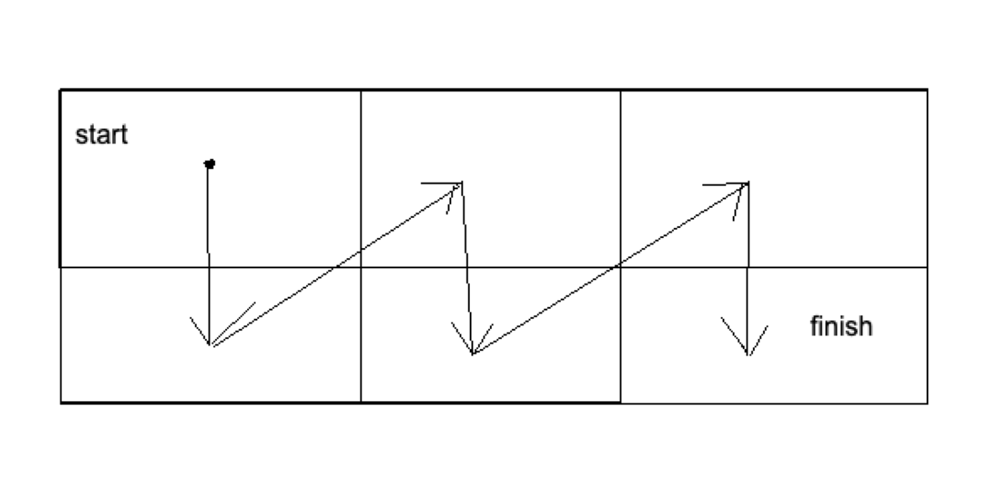

---
hide:
  - toc
---

# 2 - Sreća u matrici

=== "Zadatak"
	
	| Vremensko ograničenje | Memorijsko ograničenje |
	|:-:|:-:|
	| 1000ms | 64MB |
	
	<br>
	
	Ko nema sreću u ljubavi, ima u matrici!
	
	<br>
	
	Perica ima matricu $A$ dimenzija $2 \times N$. Njene kolone možemo numerisati brojevima od $1$ do $N$ čitano sleva nadesno. Njene redove možemo numerisati brojevima $1$ i $2$, gledajući odozgo nadole. Polje $(i,j)$ pripada $i$-tom redu i $j$-oj koloni. U polju $(i,j)$ upisana je vrednost $A[i][j]$.
	
	<br>
	
	Nakon što je priznao svojoj simpatiji i dobio negativan odgovor, Perica je odlučio da u potpunosti želi da se posveti svojoj matrici. On će, naime, započeti kretanje u polju $(1,1)$, a završiće ga u polju $(2,N)$. Samo pomeranje vrši kao na slici ispod.
	
	<br>
	
	  
	
	<br>
	
	Formalno, neka je Perica trenutno u polju $(i,j)$. Naredno polje na koje će skočiti je:
	
	* $(2,j)$; ukoliko je $i=1$.
	    
	* $(1,j+1)$; ukoliko je $i=2$ i $j<N$.
	    
	* Kretanje se završava sa krajem u polju $(2,N)$.
	
	<br>
	
	Na početku, Peričina sreća iznosi $0$ (ipak ga je simpatija odbila). Svaki put kada se prilikom kretanja desi da vrednost njegovog trenutnog polja ima istu parnost kao i vrednost njegovog prethodnog polja, Peričina sreća poraste za $1$. Napominjemo da polje $(1,1)$ nema prethodnika.
	
	<br>
	
	Kako bi bio što srećniji, Perica će izvršiti proizvoljan konačan broj (možda $0$) poteza **isključivo pre nego što započne kretanje**. U jednom potezu, on može:
	 
	* Izabrati $i$ takvo da je $1 \leq i \leq N$.
	    
	* Zameniti vrednosti $A[1][i]$ i $A[2][i]$.
	
	<br>
	
	Nakon što Perica izvrši poteze, započeće kretanje kao što je ranije opisano.
	
	<br>
	
	Pomozite Perici i ispišite najveću moguću sreću kretanja nakon izvršavanja pomenutih poteza.
	
	<br>
	
	## Opis ulaza
	
	<br>
	
	Najpre, prva linija standardnog ulaza sadrži $T$ - broj testova u okviru jednog test primera. Zatim se unose ti testovi u narednom formatu:
	
	<br>
	
	Prva linija svakog testa sadrži jedan prirodan broj $N$.
	
	<br>
	
	Druga linija svakog testa sadrži $N$ prirodnih brojeva $A[1][1], A[1][2], \ldots , A[1][N]$.
	
	<br>
	
	Treća linija svakog testa sadrži $N$ prirodnih brojeva $A[2][1], A[2][2], \ldots , A[2][N]$.
	
	<br>
	
	## Opis izlaza
	
	<br>
	
	Za svaki test, ispisati jedan broj u zasebnoj liniji - odgovor na zadatak.
	
	<br>
	
	## Primer 1
	
	<br>
	
	### Ulaz
	
	<br>
	
	```
	2
	4
	1 3 8 9
	2 8 6 6
	2
	1 2
	3 4
	```
	
	<br>
	
	### Izlaz
	
	<br>
	
	```
	4
	2
	```
	
	<br>
	
	### Objašnjenje
	
	<br>
	
	U prvom testu, Perica uzima $i=1$ i $i=4$. Nad njima izvrši po jedan potez. Njegovo kretanje posećuje polja $(1,1), (2,1), (1,2), (2,2), (1,3), (2,3), (1,4), (2,4)$ sa vrednostima, redom, $2,1,3,8,8,6,6,9$. Pri takvom, njegova sreća iznosi $4$. Može se dokazati da je ta sreća i najveća moguća.
	
	<br>
	
	U drugom testu, Perica ne mora izvršiti nijedan potez. Njegova sreća je $2$.
	
	<br>
	
	## Primer 2
	
	<br>
	
	### Ulaz
	
	<br>
	
	```
	4
	7
	1 2 3 4 5 6 7
	8 9 10 11 12 13 14
	3
	1000 3000 1500
	4000 6000 2000
	10
	1 9 3 4 2 8 3 4 1 2
	3 9 2 4 5 3 9 6 2 4
	4
	1000000000 1000000000 999999999 999999999
	1000000000 999999999 1000000000 1000000000
	```
	
	<br>
	
	### Izlaz
	
	<br>
	
	```
	6
	5
	12
	4
	```
	
	<br>
	
	## Ograničenja
	
	<br>
	
	* $1 \leq T \leq 1\,000$
	
	* $2 \leq N \leq 200\,000$
	
	* $1 \leq A[i][j] \leq 10^9$
	
	* Ukupan zbir vrednosti $N$ u svim testovima ne prelazi $200\,000$.
	
	<br>
	
	Test primeri su podeljeni u pet disjunktnih grupa:
	
	* U testovima vrednim 10 poena: $A[i][j]=1$ za sve $1\leq i \leq 2$ i $1\leq j \leq N$.
	
	* U testovima vrednim 10 poena: $N = 2$.
	
	* U testovima vrednim 10 poena: $N = 3$.
	
	* U testovima vrednim 30 poena: $N \leq 10$.
	
	* U testovima vrednim 40 poena: Bez dodatnih ograničenja.
	
	<br>
	
=== "Rešenje"
	
	| Autor | Tekst i test primeri | Analiza rešenja | Testiranje |
	|:-:|:-:|:-:|:-:|
	| Miloš Milutinović | Aleksandar Višnjić | Miloš Milutinović | Filip Bojković |
	
	## Rešenje kada je $A_{i,j} = 1$ 
	
	U ovom podzadatku će svaki skok koji Perica napravi povećati sreću, pa je rešenje jednako broju skokova, preciznije jednako je $2 \cdot N - 1$.
	
	## Rešenje kada je $N \leq 3$
	
	Kako je $N$ malo, moguće je proveriti sve slučajeve primenjenih operacija ručno i uzeti najbolje.
	
	## Rešenje kada je $N \leq 10$
	
	Slično kao u prethodnom podzadatku moguće je proveriti sve slučajeve primenjenih operacija, ali ovaj put to mora da se odradi na bolji način od ručne provere. Moguće je na primer rekurzivno izgenerisati sva stanja i zatim izračunati sreću za svako od njih. Vremenska složenost $O(2^N \cdot N)$.  
	
	## Glavno rešenje
	
	Nazovimo kolonu fiksnom ukoliko su vrednosti polja u njoj iste parnosti. Svaki skok unutar fiksne kolone sigurno ne menja sreću, dok skok u ostalim kolonama sigurno povećava sreću za jedan. Preostaje da se maksimizuje sreća skokova između kolona. Za početak posmatrajmo prvu i poslednju fiksnu kolonu. Pre prve i posle poslednje kolone moguće je napraviti, pomoću operacija, da svaki skok između kolona poveća sreću. Zatim posmatrajmo dve fiksne kolone takve da između njih nema ni jedne fiksne kolone, naime moguće je da svaku ne-fiksnu kolonu između te dve fiksne kolone, namestiti tako da skok sa prethodne kolone na nju poveća sreću, počev od najlevlje pa redom ka desno. Na kraju je preostalo izračunati sreću tako dobijene matrice. Ukupna vremenska složenost $O(N)$.
	
	``` cpp title="02_sreca_u_matrici.cpp" linenums="1"
	#include <bits/stdc++.h>
	
	using namespace std;
	
	int mat[3][200005];
	
	int sreca(vector<int>& a)
	{
	    int res = 0;
	    for (int i = 1; i < (int)a.size(); i++)
	    {
	        if (a[i] % 2 == a[i - 1] % 2) res++;
	    }
	    return res;
	}
	
	int main()
	{
	    ios_base::sync_with_stdio(false);
	    cin.tie(0), cout.tie(0);
	
	    int t; cin >> t;
	    while (t--)
	    {
	        int n; cin >> n;
	        vector<int> a;
	        for (int i = 1; i <= 2; i++)
	            for (int j = 1; j <= n; j++)
	                cin >> mat[i][j];
	        for (int j = 1; j <= n; j++)
	            for (int i = 1; i <= 2; i++)
	                a.push_back(mat[i][j]);
	
	        for (int i = 2; i < 2 * n; i += 2)
	        {
	            if (a[i + 1] % 2 == a[i - 1] % 2) swap(a[i], a[i + 1]);
	        }
	        int ans = sreca(a);
	
	        swap(a[0], a[1]);
	
	        for (int i = 2; i < 2 * n; i += 2)
	        {
	            if (a[i + 1] % 2 == a[i - 1] % 2) swap(a[i], a[i + 1]);
	        }
	        ans = max(ans, sreca(a));
	
	        cout << ans << "\n";
	    }
	}

	```
