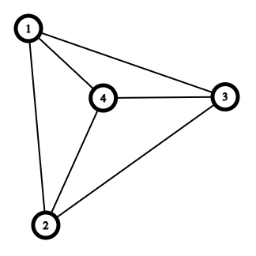
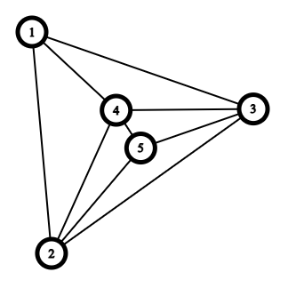
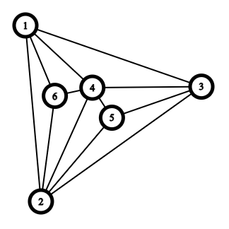

---
hide:
  - toc
---

# 3 - Putešestvije

=== "Zadatak"
	
	| Vremensko ograničenje | Memorijsko ograničenje |
	|:-:|:-:|
	| 1000ms | 256MB |
	
	
	<br>
	
	Vaspitačica Milica je odlučila da ode u novogodišnju kupovinu poklona za decu iz vrtića. Kako nije najupoznatija sa geografijom i geometrijom grada, odlučila je da koristi jednu od mnogobrojnih alternativnih aplikacija za pronalaženje najbolje rute. Naravno, kako to obično biva sa neiskusnim korisnicima i alternativnim aplikacijama, Milica se načisto izgubila u ovom logističkom lavirintu i potrebna joj je pomoć!
	
	<br>
	
	
	U gradu postoji $n$ prodavnica, a na početku dana Milica se nalazi u prodavnici označenoj brojem $1$. Neke od prodavnica su povezane ulicama i Milica želi da se kreće samo tim ulicama. Takođe, Milica želi da poseti **svaku prodavnicu tačno jednom** i **da se vrati u prodavnicu $1$ na kraju**. 
	
	<br>
	
	Prodavnice su povezane na specifičan način, iz istorijsko-građevinskih razloga. Prilikom osnivanja samog grada nastale su prodavnice $1$, $2$ i $3$, koje su sve međusobno povezane ulicama. Zatim, kada je nastala prodavnica broj $4$, sagrađena je unutar trougla prodavnica $1,2,3$ i povezana je ulicama sa sve tri prodavnice. Dalje, za svaku narednu prodavnicu $x = 5, 6, \ldots, n$ biran je trougao $abc$ (za $a,b,c = 1,2,3,\ldots,x-1$) prodavnica koji unutar sebe nema nijednu prodavnicu i u njemu je sagrađena prodavnica $x$ i povezana sa sve tri prodavnice $a,b,c$. Dodatno, poznato je da kada se prodavnica $x = 4,5,\ldots, n$ sagradi unutar trougla $abc$, **barem jedan od trouglova** $abx$, $acx$ ili $bcx$ **neće imati ubuduće sagrađenu prodavnicu unutar sebe**. Za razjašnjenje, pogledajte sliku.  
	
	<br>
	
	Vaš zadatak je da ispišete putanju prodavnica kojom vaspitačica Milica može da obiđe sve prodavnice tačno jednom, ili $-1$ ukoliko takva putanja ne postoji. Ukoliko postoji više rešenja, ispisati bilo koje.
	 
	<br>
	
	## Opis ulaza
	
	<br>
	
	U prvoj liniji standardnog ulaza dat je ceo broj $n$, broj prodavnica u gradu.
	
	<br>
	
	U narednih $n-4$ linija standardnog ulaza, nalazi se po tri cela broja - $a, b, c$. Svaka od ovih linija opisuje da se naredna prodavnica (prodavnice se grade redom po broju $5, 6, \ldots, n$) gradi unutar trougla prodavnica $a,b,c$. 
	
	<br>
	
	## Opis izlaza
	
	<br>
	
	Ukoliko rešenje ne postoji, ispisati $-1$.
	
	<br>
	
	Inače, jednoj liniji standardnog izlaza ispišite $n+1$ celih brojeva. $i$-ta vrednost predstavlja prodavnicu koju Milica obilazi $i$-tu po redu. Prvi i poslednji broj treba biti jednak $1$.
	
	<br>
	
	## Primer 1
	
	<br>
	
	### Ulaz
	
	<br>
	
	```
	6
	3 2 4
	1 2 4
	```
	
	<br>
	
	### Izlaz
	
	<br>
	
	```
	1 2 6 4 5 3 1
	```
	
	### Objašnjenje
	
	<br>
	
	Na početku je bilo samo četiri prodavnica, kao na slici ispod:
	
	
	
	Zatim, sagradila se prodavnica $5$ u trouglu $2,3,4$, kao na slici ispod:
	
	
	
	Na kraju, sagradila se i prodavnica $6$ u trouglu $1, 2, 4$, kao na slici ispod:
	
	
	
	Obratite pažnju da koliko god da je još prodavnica građeno, trougao $1,3,4$ bi ostao prazan u smislu da se nijedna prodavnica ne bi tu gradila. Ovo se garantuje tekstom zadatka. Sada jedan od puteva koji Milica može da izabere je od prodavnice $1$ do prodavnice $2$, zatim od prodavnice $2$ do prodavnice $6$, zatim od prodavnice $6$ do prodavnice $4$, zatim od prodavnice $4$ do prodavnice $5$, zatim od prodavnice $5$ do prodavnice $3$. Na kraju, potrebno je da se vrati od prodavnice $3$ do prodavnice $1$. Na ovaj način Milica obilazi svaku prodavnicu tačno jednom i vraća se u prodavnicu $1$.
	 
	<br>
	
	## Primer 2
	
	<br>
	
	### Ulaz
	
	<br>
	
	```
	7
	1 3 4
	3 4 5
	1 5 3
	```
	
	<br>
	
	### Izlaz
	
	<br>
	
	```
	1 2 3 4 6 5 7 1
	```
	
	<br>
	
	## Ograničenja
	
	
	<br>
	
	
	- $4 \leq n \leq 200.000$ 
	
	
	<br>
	
	Test primeri su podeljeni u $5$ disjunktnih grupa:
	
	
	   - U testovima vrednim $10$ poena: važi $n \leq 10$.
	   - U testovima vrednim $10$ poena: važi $n \leq 20$.
	   - U testovima vrednim $15$ poena: važi da će prodavnica svaka nova prodavnica $x = 5,6,\ldots,n$ biti sagrađena u trouglu $1,2,x-1$.
	   - U testovima vrednim $15$ poena: važi $n \leq 100$.
	   - U testovima vrednim $20$ poena: važi $n \leq 1.000$.
	   - U testovima vrednim $30$ poena: bez dodatnih ograničenja.
	
	<br>
	
=== "Rešenje"
	
	| Autor | Tekst i test primeri | Analiza rešenja | Testiranje |
	|:-:|:-:|:-:|:-:|
	| Marko Milenković | Marko Milenković | Marko Milenković | Nemanja Majski |
	
	## Rešenje kada je $N = 10$
	
	Možemo primetiti da je zapravo objekat u zadatku (prodavnice i putevi između njih) graf. Takođe, moguće je pokazati da **rešenje uvek postoji**, što će se videti iz naše konstrukcije.
	
	U ovom podzadatku, dovoljno je isprobati sve moguće permutacije čvorova. Odnosno, jedna permutacija čvorova nam predstavlja potencijalnu putanju kroz graf. Na primer, za $5$ čvorova, permutacija $1,3,2,5,4$ nam predstavlja putanju: $1-3-2-5-4-1$. Potrebno je samo proveriti da li takva putanja postoji, odnosno da li su svaka dva susedna elementa u nizu (uključujući prvi i poslednji) susedi u grafu.
	
	## Rešenje kada važi da će prodavnica svaka nova prodavnica $x = 5,6,\ldots,n$ biti sagrađena u trouglu $1,2,\ldots, x-1$.
	
	Ovaj podzadatak ima više mogućih ispravnih rešenja. Prilažemo jedno od njih. Možemo primetiti da putanja: $1->2->x->(n)->(n-1)->\ldots->4->3->1$ zadovoljava uslove iz zadatka.
	
	## Rešenje kada je $n \leq 100$, $n \leq 1.000$, ili $n \leq 200.000$
	
	Idejno rešenje za ove podzadatke je isto. Ono što se razlikuje jeste način implementacije. Na primer, čuvanje trouglova u trodimenzionalnom nizu odgovoara podzadatku kada je $n \leq 100$. Sa druge strane, neoptimalno ispitivanje da li je u trouglu sazidana nova prodavnica ili neelementarno korišćenje naprednih struktura, poput mape u C++, odgovara podzadatku kada je $n \leq 1.000$.
	
	Rešenje ćemo graditi induktivno. U početku, kada imamo samo $4$ čvora, znamo da je jedna od mogućih putanja $1->2->3->4->1$. Nadalje, naše rešenje ćemo graditi tako da svaki trougao koji će kasnije imati u sebi dodat čvor, u grafu ima bar jednu granu u traženoj putanji koja obilazi sve čvorove tačno jednom. Naivan, ali netačan, pokušaj bi bio sledeći:
	
	Posmatrajmo trenutak kada se čvor $X$ doda u trougao $ABC$ i poveže sa sva tri čvora. Pretpostavimo (na osnovu toga što smo odlučili da tako gradimo rešenje) da je grana $AB$ ona koja se do sada nalazila u traženoj putanji. Prosto možemo izbaciti granu $AB$ iz tražene putanje i umesto nje stavimo grane $AX$ i $XB$. Kako je po induktivnoj pretpostavci prethodna putanja bila korektna, tako će i ova nova. 
	
	Ovakav **pokušaj je neispravan**. Problem nastaje kada dva trougla dele istu granu u konačnoj putanji. Kada izbacimo tu zajedničku granu za prvi trougao, kasnije, kada budemo dodavali čvor u drugom trouglu, on neće imati granu u traženoj putanji - što nas dovodi do greške.
	
	Ipak, nismo daleko od rešenja. Dodaćemo strožu pretpostavku indukciji: svaki trougao kome će u nekom trenutku biti dodat čvor unutra, će imati jedinstvenu granu u traženoj putanji. Kako možemo ovo da osiguramo?
	
	U početku, kada imamo samo $4$ čvora, znamo da takva putanja postoji: $1->2->3->4->1$. Dalje, kada se čvor $X$ doda u trougao $ABC$, možemo da pretpostavimo po indukciji da jedinstvena grana dodeljena ovom trouglu biva $AB$. Sada razlikujemo tri slučaja (i ovo je zapravo deo koji je bitno implementirati optimalno):
	
	1. Trouglu $ABX$ se neće dodavati ubuduće čvorovi u unutrašnjost. Sada zamenimo granu $AB$ granama $AX$ i $XB$ u traženoj putanji. Zatim, granu $AX$ dodelimo trouglu $ACX$ kao njegovu jedinstvenu granu u traženoj putanji. Analogno, granu $BX$ dodelimo trouglu $BCX$. Primetite da sada trougao $ABX$ nema jedinstvenu granu u traženoj putanji - ali to je sasvim validno, jer njemu neće biti dalje dodavani čvorovi.
	2. Trouglu $BCX$ se neće dodavati ubuduće čvorovi u unutrašnjost. Sada zamenimo granu $AB$ granama $AX$ i $XB$ u traženoj putanji. Zatim, granu $AX$ dodelimo trouglu $ACX$ kao njegovu jedinstvenu granu u traženoj putanji. Analogno, granu $BX$ dodelimo trouglu $ABX$.
	3. Trouglu $ACX$ se neće dodavati ubuduće čvorovi u unutrašnjost. Ovaj slučaj je simetričan prethodnom.
	
	Sada imamo kompletirano rešenje, odnosno putanju koja obilazi svaki čvor tačno jednom. Predlog za konkretnu implementaciju je da se napravi mapa koja kao ključ ima trougao (trojku čvorova, ili korisničku strukturu sa tim podacima), a kao vrednost granu koja mu je dodeljena. Za više detalja pogledati komisijsko rešenje.
	
	## Za one koji žele da znaju više
	
	Ovakav tip grafova se naziva planarnim grafovima. Odnosno, to su grafovi za koje postoji crtanje tako da se nikoje dve grane ne seku. Dodatno, graf iz zadatka je po još nečemu karakterističan: nije moguće dodati nijednu granu a da se ne naruši planarnost. Ovakve grafove takođe zovemo i maksmilanim planarnim grafovima. Za više informacija: https://en.wikipedia.org/wiki/Planar_graph
	
	``` cpp title="03_putesestvije.cpp" linenums="1"
	#include <bits/stdc++.h>
	
	using namespace std;
	
	typedef long long ll;
	typedef long double ld;
	typedef pair<int, int> pi;
	typedef pair<ll, ll> pl;
	typedef vector<int> vi;
	typedef vector<ll> vl;
	typedef vector<double> vd;
	typedef vector<bool> vb;
	typedef vector<char> vc;
	typedef vector<string> vs;
	typedef vector<pi> vp;
	typedef vector<pl> vpl;
	
	void f(int& a, int& b, int& c){
	    if (a == min(min(b, c), a)){
	        if (b > c)
	            swap(b, c);
	    } else if (b == min(b, c)){
	        swap(a, b);
	        if (b > c)
	            swap(b, c);
	    } else {
	        swap(a, c);
	        if (b > c)
	            swap(b, c);
	    }
	}
	
	
	void f(int& a, int& b){
	    if (a > b)
	        swap(a,b);
	}
	
	
	struct tr
	{
	    int a;
	    int b;
	    int c;
	
	    bool operator<(const tr& other) const{
	        if (a != other.a)
	            return a < other.a;
	        if (b != other.b)
	            return b < other.b;
	        return c < other.c;
	    }
	};
	
	tr ff(int a, int b, int c){
	    f(a,b,c);
	    return tr{a,b,c};
	}
	
	map<tr, int> m;
	map<tr, pi> e;
	map<pi, int> zau;
	const int maxn = 2e5+10;
	vi g[maxn], vis(maxn);
	
	vi sol;
	
	void dfs(int x){
	    sol.push_back(x);
	    vis[x] = 1;
	
	    for (int i : g[x]){
	        if (vis[i])
	            continue;
	        dfs(i);
	    }
	}
	
	signed main()
	{
	    ios_base::sync_with_stdio(false); 
	    cin.tie(nullptr); 
	    cout.tie(nullptr); 
	    cerr.tie(nullptr);    
	
	    int n;
	    cin >> n;
	
	    vector<tr> t = {{1,2,3}};
	    m[tr{1,2,3}] = 4;
	    e[tr{1,2,3}] = {1,2};
	
	    for (int i = 5; i <= n; ++i){
	        int a, b, c;
	        cin >> a >> b >> c;
	
	        f(a,b,c);
	
	        t.push_back({a, b, c});
	        m[t.back()] = i;
	    }
	
	    set<pi> s;
	    s.insert({1,2});s.insert({2,3}); s.insert({1,3});
	    for (int i = 4; i <= n; ++i){
	        auto p = t[i-4];
	        auto h = e[p];
	
	        int u = h.first, v = h.second, x = i;
	        s.erase({u,v});
	        s.insert({u,x});
	        s.insert({v,x});
	
	
	        int w = p.c + p.a + p.b - u - v;
	        if (!m[ff(u,v,x)]){
	
	            auto q = ff(u,w,x);
	            e[q] = {u,x};
	
	            auto k = ff(v,w,x);
	            e[k] = {v,x};
	        } else if (!m[ff(u,w,x)]){
	            auto q = ff(u,v,x);
	            e[q] = {u,x};
	
	            auto k = ff(v,w,x);
	            e[k] = {v,x};
	        } else {
	            auto q = ff(u,v,x);
	            e[q] = {v,x};
	
	            auto k = ff(u,w,x);
	            e[k] = {u,x};
	        }
	    }
	
	    for (pi p : s){
	        g[p.first].push_back(p.second);
	        g[p.second].push_back(p.first);
	    }
	    dfs(1);
	
	    for (int x : sol)
	        cout << x << ' ';
	    cout << "1\n";
	}

	```
