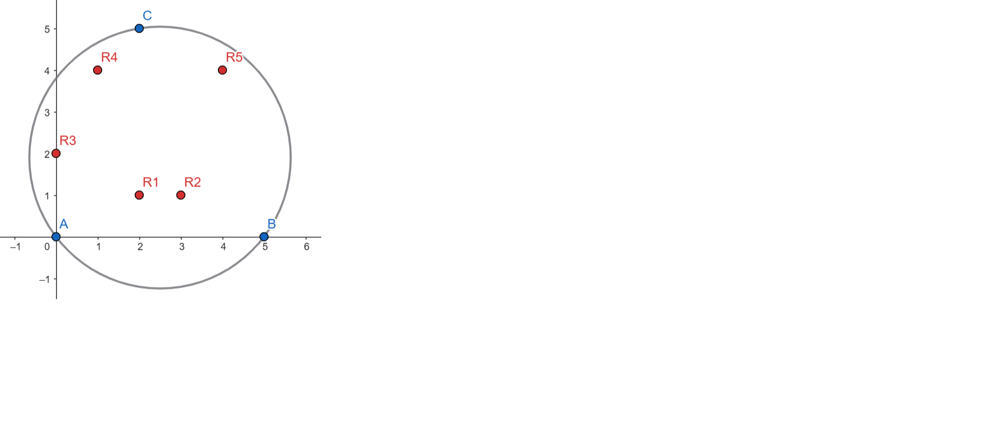
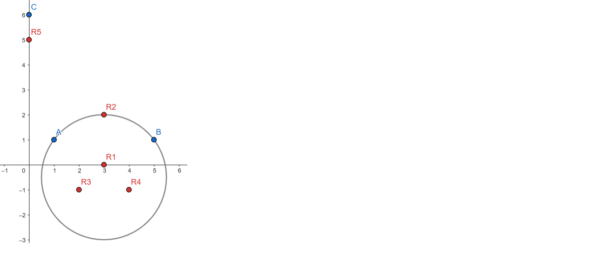

---
hide:
  - toc
---

# 3 - Radoje

=== "Zadatak"
	
	| Vremensko ograničenje | Memorijsko ograničenje |
	|:-:|:-:|
	| 1000ms | 256MB |
	
	
	<br>
	
	Boža Dunster, selektor reprezentacije Srbije na IOI-u (Implementiranje Ofsajd Inteligencije) koja se održava u Sukreu, ima svog vernog goluba Radoja. Naravno, ni Radoje ne ide tamo samo radi provoda, već je dobio ozbiljno zaduženje od Bože.
	
	<br>
	
	Naime, Boža je saznao da će svim takmičarima u Sukreu biti dodeljen po list lekovite biljke, kako bi se borili protiv visinske bolesti. Ipak, zbog loše organizacije, reprezentacija Srbije će dobiti samo $3$ lista, a pored ta tri lista, postoji još njih $n$ namenjeno ostalim reprezentacijama. Svo lišće (njih $n+3$) se nalazi na jednom ogromnom stolu. 
	
	<br>
	
	Zadatak koji je dobio Radoje jeste da ukrade što je više lišća sa stola moguće, a da pritom ne pokupi nijedan list namenjen srpskom timu. Naravno, Radoje je samo golub (a ne na primer, svraka) i može da krade na vrlo specifičan način. On želi da izabere krug proizvoljnog centra i poluprečnika na stolu za koji važi:
	1) da nema **nijedan** srpski list u svojoj **strogoj unutrašnjosti**,
	2) da maksimizuje broj tuđeg lišća **u krugu ili na njemu**.
	
	<br>
	
	Nažalost, Radoje ima samo jednu priliku u Sukreu, tako da će morati da vežba sa Božom dok su još uvek u Srbiji. Kako bi bili sasvim sigurni u Radoja, Radoje mora da reši $T$ različitih primera, gde u svakom primeru dobije broj $n$ i $n+3$ tačaka u ravni koje predstavljaju lišće i za svaki primer rešava opisani zadatak.
	 
	<br>
	
	Pomozite Radoju.
	
	## Opis ulaza
	
	<br>
	
	U prvoj liniji standardnog ulaza dat je prirodan broj $T$, broj primera.
	
	<br>
	
	Svaki od $T$ primera je opisan na sledeći način:
	
	- Prva linija primera sadrži prirodan broj $n$ - broj tuđeg lišća
	- Naredne tri linije primera sadrže po dva cela broja. Svaka od tih linija predstavlja $x$ i $y$-koordinate srpskog lišća.
	- Zatim, narednih $n$ linija primera sadrži po dva cela broja. Svaka od tih linija predstavlja $x$ i $y$-koordinate tuđeg lišća.
	
	**Garantuje se da nikoja tri lista (bilo koje pripadnosti) nisu kolinearna.**
	
	<br>
	
	## Opis izlaza
	
	<br>
	
	Za svaki od $T$ upita treba ispisati jednu liniju standardnog izlaza koja sadrži jedan ceo broj - najveći broj lišća koje Radoje može da ukrade.
	
	<br>
	
	## Primer 1
	
	<br>
	
	### Ulaz
	
	<br>
	
	```
	1
	5
	0 0
	5 0
	2 5
	2 1
	3 1
	0 2
	1 4
	4 4
	```
	
	<br>
	
	### Izlaz
	
	<br>
	
	```
	5
	```
	
	### Objašnjenje
	
	<br>
	 
	Neka su plave tačke one koje predstavljaju srpsko lišće, dok su crvene one koje predstavljaju lišće drugih reprezentacija. Radoje može da posmatra opisani krug plavih tačaka i na taj način će ukrasti sve crvene tačke, što je svakako maksimum. Možete pogledati primer na slici:
	
	
	<br>
	
	## Primer 2
	
	<br>
	
	### Ulaz
	
	<br>
	
	```
	1
	5
	1 1
	5 1
	0 6
	2 -1
	4 -1
	3 0
	3 2
	0 5
	```
	
	<br>
	
	### Izlaz
	
	<br>
	
	```
	4
	```
	
	<br>
	
	### Objašnjenje
	
	<br>
	 
	Neka su plave tačke one koje predstavljaju srpsko lišće, dok su crvene one koje predstavljaju lišće drugih reprezentacija. Radoje može da posmatra opisani krug oko tačaka $A$, $B$ i $R_2$ i na taj način će ukrasti četiri crvene tačke (setite se da se crvena tačka računa kao ukradena i ako je na obimu kruga). Moguće je pokazati da Radoje ne može da ukrade svih pet listova. Možete pogledati primer na slici:
	
	
	<br>
	
	## Ograničenja
	
	
	<br>
	
	
	- $1 \leq T \leq 1000$
	- $1 \leq n \leq 10^{5}$ 
	- Apsolutne vrednosti $x$ i $y$ koordinata svog lišća je najviše $10^9$
	- Garantuje se da nikoja tri lista (bilo koje pripadnosti) nisu kolinearna.
	
	Garantuje se da ukupan broj tačaka u svim primerima ne prelazi $2\cdot10^5$.
	
	<br>
	
	Test primeri su podeljeni u $8$ disjunktnih grupa:
	
	   
	   - U testovima vrednim $2$ poena: Svo lišće tuđih reprezentacija se nalazi u trouglu koji formiraju listovi reprezentacije Srbije.
	   - U testovima vrednim $5$ poena: Postoji neki maksimalni skup $S$ lišća koji Radoje može da ukrade i koji se nalazi u  krugu koji formiraju listovi reprezentacije Srbije i apsolutne vrednosti koordinata su najviše $10^6$.
	   - U testovima vrednim $10$ poena: važi $n \leq 10$ i $T \leq 10$ i apsolutne vrednosti koordinata su najviše $10^6$.
	   - U testovima vrednim $15$ poena: Neka je neki $S$ maksimalni skup lišća koji Radoje može da ukrade. Postoji prava kojoj je sa jedne strane skup $S$, a sa druge strane lišće reprezentacije Srbije. 
	   - U testovima vrednim $13$ poena: važi $n \leq 80$ i $T \leq 5$ i apsolutne vrednosti koordinata su najviše $10^6$.
	   - U testovima vrednim $15$ poena: važi $n \leq 300$ i $T \leq 5$ i apsolutne vrednosti koordinata su najviše $10^6$.
	   - U testovima vrednim $17$ poena: važi $n \leq 3000$ i $T \leq 5$ i apsolutne vrednosti koordinata su najviše $10^6$.
	   - U testovima vrednim $23$ poena: bez dodatnih ograničenja.
	
	<br>
	
=== "Rešenje"
	
	| Autor | Tekst i test primeri | Analiza rešenja | Testiranje |
	|:-:|:-:|:-:|:-:|
	| Marko Milenković | Marko Milenković | Marko Milenković | Jovan Bengin |
	
	### Napomena
	
	Za potrebe lakšeg izražavanja, lišće reprezentacije Srbije nazivaćemo plavim tačkama, a ostala lišća crvenim tačkama.
	
	###  Svo lišće tuđih reprezentacija se nalazi u trouglu koji formiraju listovi reprezentacije Srbije.
	
	U ovom podzadatku, optimalan krug biće opisani krug oko tri plave tačke. Ipak, kako su sve crvene tačke unutar trougla, možemo da zaključimo da će sve crvene tačke i biti u opisanom krugu. Tako da je rešenje u ovom podzadatku jednostavno $n$.
	
	###  Postoji neki maksimalni skup $S$ lišća koji Radoje može da ukrade i koji se nalazi u krugu koji formiraju listovi reprezentacije Srbije.
	
	U ovom podzadatku, potrebno je pronaći opisani krug plavih tačaka i proveriti koje tačke se nalaze u njemu. Centar kruga nalazimo kao presek simetrala neke dve stranice trougla. Zatim, poluprečnik kao rastojanje od centra do proizvoljne plave tačke. Za više detalja: https://www.geeksforgeeks.org/program-find-circumcenter-triangle-2/
	
	### $n, T <= 10$
	
	U ovom podzadatku možemo proveriti za svaki podskup crvenih tačaka, da li najmanji krug koji ih sadrži, sadrži i neku plavu tačku. Za rešenje biramo najveći podskup za koji se to ne dešava.
	
	### Neka je neki S maksimalni skup lišća koji Radoje može da ukrade. Postoji prava kojoj je sa jedne strane skup  S, a sa druge strane lišće reprezentacije Srbije.
	
	Uočimo scenario iz opisa ovog podzadatka. Pomenutu pravu možemo da pomeramo ka plavom trouglu, dok ne "udarimo" u teme trougla. Na ovaj način definitivno nismo smanjili broj crvenih tačaka u poluravni koju ova prava definiše. 
	
	Krug je jednoznačno definisan svojim poluprečnikom i tangentom na tački na obodu. Možemo kao tačku na obodu da fiksiramo kao teme plavog trougla i pomenutu pravu od ranije kao tangentu. Zatim ako centar kruga pomeramo u suprotnom smeru od plavog trougla (formalno normalno u odnosu na tangentu), krug će rasti i u jednom trenutku pokupiće sve crvene tačke koje se nalaze sa druge strane prave. Po uslovu podzadatka, ovo je najveći skup koji možemo da pokupimo.
	
	Kako bismo pronašli ovaj skup u praksi, za svaku plavu tačku sortiramo crvene tačke u cirkularnom redosledu. Pomoću klizajućeg prozora tražimo skup crvenih tačaka gde prva i poslednja formiraju ugao sa plavom tačkom manji od 180 stepeni. Ovo možemo zamisliti kao da rotiramo pravu oko plave tačke i gledamo koje crvene se nalaze sa suprotne strane u odnosu na trougao. I sve te tačke smo pokazali da možemo da pokupimo krugom.
	
	Složenost ovog pristupa je $\mathcal{O}(n\log n)$.
	
	### $n <= 100$, $T <= 5$
	
	Za svaku trojku crvenih tačaka možemo da pronađemo opisani krug. Ako ovaj krug sadrži plavu tačku, ignorišemo ga. U suprotnom, izbrojimo koliko crvenih tačaka je u njemu i rešenje će biti krug sa najbiše crvenih tačaka unutra.
	
	### Bez dodatnih ograničenja
	
	Posmatrajmo optimalan krug. Postoji nekoliko mogućih scenarija:
	
	#### Optimalan krug sadrži tri plave tačke na obodu
	
	Ovo je drugi podzadatak. Potrebno je pronaći opisani krug plavog trougla.
	
	#### Optimalni krug sadrži dve plave tačke na obodu
	
	Centar kruga se onda nalazi na simetrali ove dve tačke. Ideja nam je da pomeramo centar kruga (kada fiksiramo centar i dve tačke na obodu, jasno je da je krug jedinstven) od centra opisanog kruga pa ka beskonačnosti (u suprotnom smeru od treće plave tačke). Među svim ovim opcijama biramo krug sa najviše crvenih tačaka. Međutim, problem nastaje što imamo suviše opcija.
	
	Pretpostavimo da je simetrala naše dve plave tačke deo $x$-ose. Ovo smemo da pretpostavimo jer uvek možemo da potiramo i transliramo ravan tako da važi. Znamo tačnu vrednost $x$-koordinate koja predstavlja granicu do opisanog kruga (ako prekoračimo ovu vrednost, uhvatićemo treću plavu tačku unutar kruga, što nije dozvoljeno). Za svaku crvenu tačku želimo da nađemo interval na $x$-osi za koji važi da kada je centar kruga u njemu, crvena tačka će biti u krugu. Ukoliko se crvena tačka nalazi levo (suprotno od treće plave tačke) od stranice trougla koju formiraju naše dve plave tačke, onda će crvena tačka biti u krugu od minus beskonačnosti do neke vrednosti $x_o$. Ukoliko je crvena tačka s desne strane, onda će tačka biti u krugu od neke vrednosti $x_o$ do centra opisanog kruga.
	
	
	Neka su koordinate crvene tačke $(x,y)$. Neka su koordinate jedne od dve plave tačke $(x_p, y_p)$ Želimo da izračunamo vrednost $x_o$. Neka je $r$ poluprečnik trenutnog kruga. Onda važi:
	
	\begin{eqnarray*}
	    (x-x_o)^2 + (y-y_o)^2 &\leq& r^2\\
	    (x-x_o)^2 + (y-0)^2 &\leq& (x_p - x_o)^2 + (y_p - 0)^2\\
	    x^2 - 2xx_o + x_o^2 + y^2 &\leq& x_p^2 -2x_px_o + x_o^2 + y_p^2\\
	    2x_px_o - 2xx_o &\leq& x_p^2 + y_p^2 - x^2 -y^2\\
	    x_o\cdot2(x_p-x) &\leq& x_p^2 + y_p^2 - x^2 -y^2\\
	\end{eqnarray*}
	
	Sada razlikujemo tri slučaja, da li je $x_p - x$ pozitivno, negativno ili nula:
	
	    \begin{enumerate}
	        \item Ako je $x_p - x = 0$, to znači da je $(x,y)$ kolinearno sa dve plave tačke. Po tekstu zadatka znamo da su sve tačke u opštem položaju, tako da ovaj slučaj nije moguć
	
	        \item Ako je $x_p - x > 0$, to znači da je $(x,y)$ "levo" od dveju plavih tačaka. Onda svaki krug čiji je centar u $(x_o, 0)$ gde važi $x_o \leq \frac{x_p^2 + y_p^2 - x^2 -y^2}{2(x_p-x)}$, sadrži crvenu tačku $(x,y)$. Za ostale centre, čija je $x$-koordinata veća od ovog razlomka, tačka $(x,y)$ nije u njima.
	
	        
	        \item Ako je $x_p - x < 0$, to znači da je $(x,y)$ "desno" od dveju plavih tačaka. Onda svaki krug čiji je centar u $(x_o, 0)$ gde važi $x_o \geq \frac{x_p^2 + y_p^2 - x^2 -y^2}{2(x_p-x)}$, sadrži crvenu tačku $(x,y)$. Za sve ostale centre, čija je $x$-koordinata manja od ovog razlomka, tačka $(x,y)$ nije u njima.
	    \end{enumerate}
	
	Sada možemo da primenimo tehniku klizajućeg prozora. Sortiramo tačke po vrednosti $x_o$ (samo one tačke koje ne probijaju granicu za centar opisanog kruga). U početku sve tačke koje su levo od dveju plavih tačaka bivaju u početnom krugu (zamišljamo da je centar kruga u minus beskonačnosti). Onda pomeramo centar kruga na sledeću vrednost $x_o$. Ukoliko je ovo vrednost za crvenu tačku levo od plavih tačaka, onda smanjujemo brojač. Ukoliko je ovo vrednost za crvenu tačku desno od plavih tačaka, onda povećavamo brojač. Rešenje je najveći brojač u bilo kom trenutku.
	
	Vremenska složenost ovog rešenja je $\mathcal{O}(n\log n)$
	
	#### Optimalni krug sadrži jednu plavu tačku na obodu
	
	Ukoliko pomeramo centar kruga u suprotnom smeru od plave tačke, krug će rasti i uvek biti nadskup početnog kruga. Ukoliko u bilo kom trenutku krug "udari" u drugu plavu tačku, nalazimo se u prethodnom slučaju, koji smo već pokrili i ne moramo ništa da rešavamo.
	
	Ukoliko krug može beskonačno da raste, padamo u četvrti podzadatak, koji smo već videli kako možemo da rešimo.
	
	#### Optimalni krug ne sadrži nijednu plavu tačku na obodu
	
	Fiksiramo centar i povećavamo poluprečnik. U jednom trenutku moramo da "udarimo" u plavu tačku i onda upadamo u prethodni slučaj.
	
	Dakle, ukupna složenost celog rešenja je $\mathcal{O}(n\log n)$
	
	``` cpp title="03_radoje.cpp" linenums="1"
	#include <bits/stdc++.h>
	
	using namespace std;
	
	#define int ll
	typedef long long ll;
	typedef long double ld;
	typedef pair<int, int> pi;
	typedef pair<ll, ll> pl;
	typedef vector<int> vi;
	typedef vector<ll> vl;
	typedef vector<double> vd;
	typedef vector<bool> vb;
	typedef vector<char> vc;
	typedef vector<string> vs;
	typedef vector<pi> vp;
	typedef vector<pl> vpl;
	
	const ld PI = 4.0*atan(1.0);
	
	struct pt{
	    ld x;
	    ld y;
	
	    friend ostream& operator<<(ostream& os, const pt& p) {
	        return os << "(" << p.x << ", " << p.y << ")";
	    }
	};
	
	
	double cross(const pt& O, const pt& A, const pt& B) {
	    return (A.x - O.x) * (B.y - O.y) - (A.y - O.y) * (B.x - O.x);
	}
	
	ld sq(ld x){
	    return x*x;
	}
	
	ld sq_dist(pt a, pt b){
	    return sq(a.x-b.x) + sq(a.y-b.y);
	}
	
	pair<pt, ld> centar(const pt& A, const pt& B, const pt& C) {
	    ld D = 2 * (A.x * (B.y - C.y) + B.x * (C.y - A.y) + C.x * (A.y - B.y));
	
	    ld Ux = ((A.x * A.x + A.y * A.y) * (B.y - C.y) +
	             (B.x * B.x + B.y * B.y) * (C.y - A.y) +
	             (C.x * C.x + C.y * C.y) * (A.y - B.y)) / D;
	
	    ld Uy = ((A.x * A.x + A.y * A.y) * (C.x - B.x) +
	             (B.x * B.x + B.y * B.y) * (A.x - C.x) +
	             (C.x * C.x + C.y * C.y) * (B.x - A.x)) / D;
	
	    pt center = {Ux, Uy};
	    ld radius = ((center.x - A.x) * (center.x - A.x) + (center.y - A.y) * (center.y - A.y));
	
	    return {center, radius};
	}
	
	int n, m;
	vector<pt> blue, red;
	
	void cw(){
	    if (cross(blue[0], blue[1], blue[2]) > 0) {
	        swap(blue[1], blue[2]);
	    }
	}
	
	void movex(const pt& A, const pt& B) {
	    pt mid = {(A.x + B.x) / 2, (A.y + B.y) / 2};
	    for (auto& p : red) {
	        p.x -= mid.x;
	        p.y -= mid.y;
	    }
	    for (auto& p : blue) {
	        p.x -= mid.x;
	        p.y -= mid.y;
	    }
	}
	void rotate(const pt& A, const pt& B) {
	    ld angle = atan2(B.y - A.y, B.x - A.x);
	    ld rotate_angle = PI/2 - angle; // rotate so AB becomes vertical
	
	    for (auto& p : blue) {
	        ld x_shifted = p.x - A.x;
	        ld y_shifted = p.y - A.y;
	
	        ld x_new = cos(rotate_angle) * x_shifted - sin(rotate_angle) * y_shifted;
	        ld y_new = sin(rotate_angle) * x_shifted + cos(rotate_angle) * y_shifted;
	
	        p.x = x_new;
	        p.y = y_new;
	    }
	
	    for (auto& p : red) {
	        ld x_shifted = p.x - A.x;
	        ld y_shifted = p.y - A.y;
	
	        ld x_new = cos(rotate_angle) * x_shifted - sin(rotate_angle) * y_shifted;
	        ld y_new = sin(rotate_angle) * x_shifted + cos(rotate_angle) * y_shifted;
	
	        p.x = x_new;
	        p.y = y_new;
	    }
	}
	
	const ld inf = INT32_MAX;
	
	int solve2(int ind){
	    
	    pt a = blue[ind];
	    pt b = blue[(ind+1+90)%3];
	    pt c = blue[(ind+2+90)%3];
	
	    rotate(a, b);
	    a = blue[ind];
	    b = blue[(ind+1+90)%3];
	    c = blue[(ind+2+90)%3];
	
	    
	    movex(a, b);
	
	    a = blue[ind];
	    b = blue[(ind+1+90)%3];
	    c = blue[(ind+2+90)%3];
	
	    
	
	    vd vals(n, 0);
	    auto cr = centar(a,b,c);
	    ld rval = (sq(a.x) + sq(a.y) - sq(c.x) - sq(c.y))/(2*(a.x-c.x));
	    
	
	    //-1 znaci levo
	    int rz = -1;
	
	    if (a.x - c.x < 0)
	        rz = 1;
	        
	    vector<pair<ld, int>> t;
	    
	    int cnt = 0;
	    for (int i = 0; i < n; ++i){
	        vals[i] = (sq(a.x) + sq(a.y) - sq(red[i].x) - sq(red[i].y))/(2*(a.x-red[i].x));
	
	        int z = -1;
	        if (a.x-red[i].x < 0)
	            z = 1;
	
	
	        if (z * rz == -1){
	            t.push_back({vals[i], z});
	            if (z == -1) ++cnt;
	        }
	        else if (z == 1){
	
	            if (vals[i] < rval){
	                t.push_back({vals[i],z});
	            }
	        } else {
	            if (vals[i] > rval){
	                ++cnt;
	                t.push_back({vals[i],z});
	            }
	        }
	    }
	
	    sort(t.begin(), t.end());
	
	    int sol = 0;
	
	    for (int i = 0; i < t.size(); ++i){
	        if (t[i].second == -1)
	            --cnt;
	        else
	            ++cnt;
	
	        sol = max(sol, cnt);
	    }
	
	    return sol;
	}
	
	bool unutra(const pt& A, const pt& B, const pt& C, const pt& P) {
	    ld cross1 = cross(A, B, P);
	    ld cross2 = cross(A, P, C);
	    ld crossAC = cross(A, B, C);
	
	    if (crossAC >= 0) {
	        return cross1 >= 0 && cross2 >= 0;
	    } else {
	        return cross1 <= 0 && cross2 <= 0;
	    }
	}
	
	ld angle(const pt& A, const pt& B, const pt& C) {
	    pt BA = {A.x - B.x, A.y - B.y};
	    pt BC = {C.x - B.x, C.y - B.y};
	
	    ld dot_product = BA.x * BC.x + BA.y * BC.y;
	    ld norm_BA = sqrt(BA.x * BA.x + BA.y * BA.y);
	    ld norm_BC = sqrt(BC.x * BC.x + BC.y * BC.y);
	
	    return acos(dot_product / (norm_BA * norm_BC));
	}
	
	bool seku(const pt& A, const pt& B, const pt& C, const pt& D) {
	    pt dir = {D.x - C.x, D.y - C.y};
	
	    pt normal = {-dir.y, dir.x};
	
	    ld sideA = (A.x - C.x) * normal.x + (A.y - C.y) * normal.y;
	    ld sideB = (B.x - C.x) * normal.x + (B.y - C.y) * normal.y;
	
	    if (sideA * sideB > 0) return false; 
	
	    ld denom = (B.x - A.x) * normal.x + (B.y - A.y) * normal.y;
	    if (abs(denom) < 1e-12) return false;
	
	    ld t = ((C.x - A.x) * normal.x + (C.y - A.y) * normal.y) / denom;
	
	    if (t < 0 || t > 1) return false; 
	
	    pt intersection = {
	        A.x + (B.x - A.x) * t,
	        A.y + (B.y - A.y) * t
	    };
	
	    ld along_ray = (intersection.x - C.x) * dir.x + (intersection.y - C.y) * dir.y;
	
	    return along_ray >= 0;
	}
	
	ld angle_from_base(const pt& A, const pt& B, const pt& R) {
	    ld dx = B.x - A.x;
	    ld dy = B.y - A.y;
	
	    ld vx = R.x - A.x;
	    ld vy = R.y - A.y;
	
	    ld cross = dx * vy - dy * vx;
	    ld dot = dx * vx + dy * vy;
	
	    ld angle = atan2l(cross, dot);
	    if (angle < 0)
	        angle += 2 * PI;
	    return angle;
	}
	
	int tmpc;
	int solve3(pt a, pt b, pt c){
	    ++tmpc;
	
	    vector<pair<ld,int>> angles;
	    for (int i = 0; i < n; ++i){
	        pt p = red[i];
	
	        if (unutra(a,b,c,p)) continue;
	
	        angles.push_back({angle_from_base(a,b,p), i});
	     //   cout << "ANGLE " << p << ' ' << angle_from_base(a,b,p) << '\n';
	    }
	
	    sort(angles.begin(), angles.end());
	    //cout << (int)angles.size() << "---";
	
	    int l = 0, r = 0, sol = 0, len = angles.size();
	    while(r < len){
	
	       // cout << "TESTIRAM " << seku(red[angles[l].second],red[angles[r].second], a, b) << ' ';
	        //cout << l << ' ' << r << ' ' << red[angles[l].second] << ' ' << red[angles[r].second] << ' ';
	        //cout << a << ' ' << b << '\n';
	        while(seku(red[angles[l].second],red[angles[r].second], a, b) || seku(red[angles[l].second],red[angles[r].second], a, c)){
	            ++l;
	        }
	
	        sol = max(sol, r-l+1);
	        ++r;
	    }
	
	    return sol;
	}
	
	signed main()
	{
	    ios_base::sync_with_stdio(false); 
	    cin.tie(nullptr); 
	    cout.tie(nullptr); 
	    cerr.tie(nullptr); 
	
	    int test;
	    cin >> test;
	
	    while(test--){
	
	    cin >> n;
	    m=3;
	
	    blue = vector<pt>(m);
	    for(auto& i : blue)
	        cin >> i.x >> i.y;
	
	    cw();
	
	    red = vector<pt>(n);
	    for(auto& i : red)
	        cin >> i.x >> i.y;
	
	    auto cr = centar(blue[0], blue[1], blue[2]);
	    auto c = cr.first;
	    auto r = cr.second;
	
	    int cnt = 0, sol = 0;
	    for (pt p : red){
	        if (sq_dist(p,c) <= r){
	            ++cnt;
	        }
	    }
	
	    sol = cnt;
	    //cout << sol << '\n';
	
	    for (int i = 0; i < m; ++i){
	        int res = solve3(blue[i], blue[(i-1+90)%3], blue[(i-2+90)%3]);
	        sol = max(sol, res);
	
	     //   cout << res << ' ';
	    }
	
	
	    for (int i = 0; i < m; ++i){
	        int res = solve2(i);
	        sol = max(sol, res);
	   //     cout << res << ' ';
	    }
	    cout << sol << '\n';
	}
	}

	```
