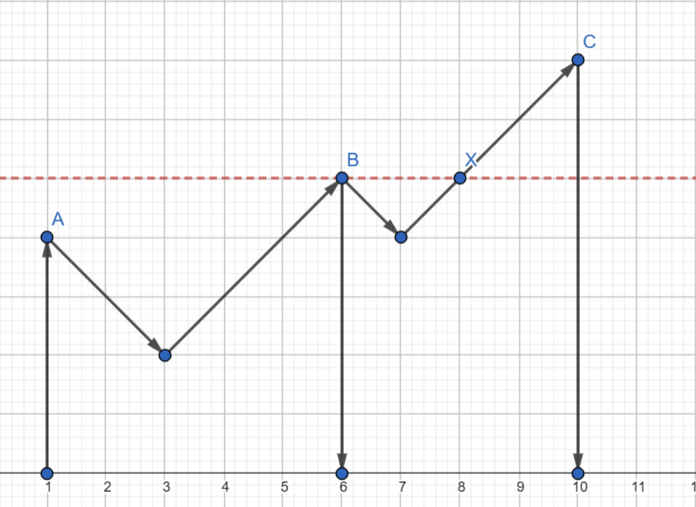

---
hide:
  - toc
---

# 3 - Džek Vrabac

=== "Zadatak"
	
	| Vremensko ograničenje | Memorijsko ograničenje |
	|:-:|:-:|
	| 1000ms | 64MB |
	
	
	<br> Džek Vrabac je osvojio novi dvodimenzionalni brod, po imenu Levitirajući Tamnjaničar. Brod možemo predstaviti kao Dekartov koordinatni sistem tako da je pramac na $(0,0)$ a krma na $(10^9,0)$. Na brodu ima $n$ jarbola koji se nalaze na udaljenostima $x_1, x_2,\dots ,x_n$ od pramca broda i njihove visine su $h_1, h_2,\dots ,h_n$. Između dva susedna jarbola vezan je magični kanap. Kanap posmatramo kao liniju koja do jednog trenutka ima nagib $-1$, a odatle $+1$ (pogledati sliku, ignorisati strelice). Garantuje se da je uvek moguće povezati dva susedna jarbola magičnim kanapom. Možemo primetiti da se to onda može uraditi na jedinstven način. Džeka interesuje za svaki jarbol koliko mu je blizu najbliži deo na brodu (tačka na jarbolu ili kanapu) koji je barem te visine. Ako nema takvog, ispisati -1. <br>
	## Opis ulaza  
	U prvoj liniji standardnog ulaza dat je ceo broj $n$, broj jarbola. <br> U drugoj liniji dato je $n$ celih brojeva $x_1,x_2,\dots ,x_n$ koji predstavljaju udaljenosti jarbola od pramca broda. 
	U trećoj liniji dato je $n$ celih brojeva $h_1,h_2,\dots ,h_n$ koji predstavljaju visine jarbola.
	## Opis izlaza  
	Ispisati $n$ linija. U liniji $i$ ukoliko ne postoji deo broda koji zadovoljava uslov za jarbol $i$ ispisati $-1$, a ako postoji ispisati udaljenost između vrha jarbola $i$ i tog dela. 
	## Primer 1
	### Ulaz
	 ```
	 3 
	1 6 10 
	4 5 7
	``` 
	### Izlaz  
	 ```
	4
	2
	 -1
	 ```  
	### Objašnjenje  
	Slika odgovara ovom primeru. Jarboli su obeleženi sa $A,B,C$ . Tačka $X$ je najbliža tačka koja je viša ili jednaka od $B$. Za $C$ nemamo takvu, a za $A$ će biti tačka (5,4).


	

	<br>
	
	## Ograničenja  
	- $1 \leq n \leq 10^7$  
	- $0 \leq x_i,h_i \leq 10^{9}$
	- $x_i \neq x_j$ za $i \neq j$
	- Garantuje se da je moguće vezati magični kanap između svaka dva susedna jarbola
	- Garantuje se za svaki magični kanap da ako menja svoj nagib onda ga menja u celobrojnoj tački
	
	Test primeri su podeljeni u $5$ disjunktnih grupa:
	 - U testovima vrednim $10$ poena: važi $n,x_i,h_i \leq 5$.
	 - U testovima vrednim $20$ poena: važi $n,x_i,h_i \leq 100$. 
	 - U testovima vrednim $20$ poena: važi $n \leq 1000$.
	 -  U testovima vrednim $20$ poena: važi $n \leq 200000$.
	 - U testovima vrednim $30$ poena: bez dodatnih ograničenja. 
	
	
	
=== "Rešenje"
	
	| Autor | Tekst i test primeri | Analiza rešenja | Testiranje |
	|:-:|:-:|:-:|:-:|
	| Marko Milenković | Uroš Kostadinović | Anja Dožić | Sofija Čebašek |
	
	## Opservacija
	
	Posmatrajmo jarbol $i$ koji se nalazi na poziciji $x_i$ visine $h_i$ i njemu najbliži jarbol koji je viši od njega i nalazi mu se sa leve strane tj. najbliži jarbol $j$ za koji važi $h_j>h_i$ i $x_j<x_i$ (pretpostavimo da takav jarbol postoji). 
	
	Kako su svi jarboli koji se potencijalno nalaze između njih niži od oba posmatrana jarbola (i $i$ i $j$), magični konopac koji se prostire između njih nikada neće dostići visinu $h_i$. Dakle najbliže mesto sa leve strane gde se pojavljuje konopac ili jarbol koji je bar visine $h_i$ mora biti na magičnom konopcu koji kreće iz jarbola $j$.
	
	Znamo da će nagib konopca na početku biti $-1$, tj. da će se konopac spustiti na visinu $h_i$ na udaljenosti tačno $h_j-h_i$ od jarbola $j$. Znamo da se promena nagiba neće dogoditi pre nego što kanap dođe do tražene visine zato što se nagib menja na visini koja je niža od susednog jarbola, a mi iz pretpostavke znamo da je susedni jarbol ili posmatrani jarbol $i$ ili neki jarbol koji je niži od oba $i$ i $j$.
	
	Konačno, kako znamo da je udaljenost između posmatrana dva jarbola $x_i-x_j$ i znamo da je najbliža tačka iste visine kao jarbol $i$ na udaljenosti $h_j-h_i$ od jarbola $j$, dobijamo da je udaljenost jarbola $i$ od njemu najbliže tačke sa leve strane koja je iste visine kao i on $x_i-x_j-(h_j-h_i)$.
	
	Analogno dobijamo da će udaljenost jarbola $i$ od njemu najbliže desne tačke koja je bar njegove visine biti $x_j-x_i-(h_j-h_i)$.
	
	## Podzadatak 1: $N\leq 1000$
	
	Za ovaj podzadatak je dovoljno da na početku sortiramo jarbole po njihovoj $x$ koordinati i zatim za svaki jarbol prođemo kroz niz tražeći poziciju najbližeg višeg jarbola. Kada nađemo tu poziciju, udaljenost ćemo izračunati kao što je objašnjeno iznad.
	
	Vremenska složenost: $O(N^2)$
	
	Memorijska složenost: $O(N)$
	
	## Podzadatak 2: $N\leq 2\cdot 10^5$
	
	U ovom podzadatku, jarbole ćemo sortirati po visini.
	
	Kada ih tako sortiramo ići ćemo redom od najvišeg do najnižeg i ubacivati ih u set. Pre nego što ubacimo jarbol $i$ u set, pronaći ćemo njemu najbliži jarbol koji je već u setu. Ovo možemo uraditi pomoću funkcije $lower\_bound$ koja radi u $O( \log N)$. Kada pronađemo taj jarbol, na ranije objašnjen način ćemo izračunati njegovu udaljenost od tražene tačke i dobiti rešenje.
	
	Kako ubacujemo jarbole redom od najvišeg do najnižeg, znamo da će u svakom trenutku u setu biti samo viši ili jednaki jarboli od posmatranog (treba obratiti posebnu pažnju na implementaciju slučaja kada imamo više jarbola iste visine, jer je to jedini slučaj kada neće u svakom trenutku svi viši ili jednaki jarboli biti u setu).
	
	Vremenska složenost: $O(N \log N)$
	
	Memorijska složenost: $O(N)$
	
	## Podzadatak 3: Celo rešenje
	
	Za celo rešenje ćemo, kao i u prvom podzadatku, jarbole sortirati po $x$ koordinati. Kako bismo našli najbliži viši za svaki od jarbola, prolazićemo kroz niz dva puta, jednom sa leve i jednom sa desne strane i ubacivaćemo elemente u stek. 
	
	Počnimo sa gledanjem jarbola sa leve strane. Neka se nalazimo na $i$-tom elementu. Sa vrha steka brišemo elemente koji su niži od trenutnog, zato što će trenutni element biti bliži i viši od svih elemenata desno od njega koji su takođe niži od obrisanih elemenata. Dakle, ti elementi nam neće biti relevantni. Kada sklonimo sve elemente koji su manji od posmatranog, ukoliko stek nije prazan levo od njega postoje viši elementi, a onaj na vrhu je najbliži. Ako postoji viši element, izračunaćemo udaljenost od tačke koja je bar visine posmatranog jarbola po formuli koju smo ranije dobili. Na kraju posmatrani element dodajemo na stek i nastavljamo na isti način prolazak kroz niz.
	
	Analogno ćemo proveriti i za najbliže desne jarbole.
	
	Primetimo da će $-1$ biti ispisano samo u slučaju kada imamo tačno jedan maksimum jer jedino tada neće postojati tačka na brodu koja je bar te visine.
	
	Vremenska složenost: $O(N log N)$
	
	Memorijska složenost: $O(N)$
	
	## Napomena
	
	Iako je vremenska složenost u drugom podzadatku ista kao i u celom rešenju, zbog većih konstanti i korišćenja seta koji je sporiji, rešenje iz drugog podzadatka će davati samo 70 poena.
	
	
	``` cpp title="03_dzek_vrabac.cpp" linenums="1"
		
	#define here cerr<<"===========================================\n"
	#define dbg(x) cerr<<#x<<": "<<x<<endl;
	#include "bits/stdc++.h"
	//#include <ext/pb_ds/tree_policy.hpp>
	//#include <ext/pb_ds/assoc_container.hpp>
	#define ld double
	#define ll int
	#define llinf 2000000000 // 10^17
	#define pb push_back
	#define popb pop_back
	#define fi first
	#define sc second
	#define endl '\n'
	#define pll pair<ll,ll>
	#define pld pair<ld,ld>
	#define all(a) a.begin(),a.end()
	#define ceri(a,l,r) {cerr<<#a<<": ";for(ll i_ = l;i_<=r;i_++) cerr<<a[i_]<< " ";cerr<<endl;}
	#define cer(a) {cerr<<#a<<": ";for(ll x_ : a) cerr<<x_<< " ";cerr<<endl;}
	#define yes cout<<"YES"<<endl
	#define no cout<<"NO"<<endl
	#define si(s) (ll)(s.size())
	
	#define daj_mi_malo_vremena ios_base::sync_with_stdio(false);cerr.tie(0);cout.tie(0);cin.tie(0);
	
	using namespace std;
	//using namespace __gnu_pbds;
	/*
	ll add(ll x,ll y){
	    x+=y;
	    if(x<0){
	        x+=mod;
	    }else{
	        if(x>=mod) x-=mod;
	    }
	    return x;
	}
	ll mul(ll a,ll b){
		ll ans = (a*b)%mod;
		if(ans<0) ans+=mod;
		return ans;
	}
	ll po(ll x,ll y){
	    if(y==0) return 1LL;
	    ll ans = po(x,y/2);
	    ans = mul(ans,ans);
	    if(y&1) ans = mul(ans,x);
	    return ans;
	}
	ll inv(ll x){return po(x,mod-2);}
	*/
	/*
	typedef tree<int,null_type,less<ll>,rb_tree_tag,tree_order_statistics_node_update> ordered_set;
	typedef tree<int,null_type,less_equal<ll>,rb_tree_tag,tree_order_statistics_node_update> ordered_multiset;
	mt19937_64 rng(chrono::steady_clock::now().time_since_epoch().count());
	ll rnd(ll l,ll r){
	    return uniform_int_distribution<ll>(l,r)(rng);
	}
	*/
	using ar3 = array<ll,3>;
	
	const ll maxn = 1000005;
	const ll mx = 1000000000;
	ll n;
	ar3 a[maxn];
	ll ans[maxn];
	void reshi(){
	    stack<ll> st;
	    for(ll i = 1;i<=n;i++){
	        ll id = a[i][2];
	        while(!st.empty()&&a[i][1]>a[st.top()][1]) st.pop();
	        if(!st.empty()){
	            ll j = st.top();
	            //j - prvi levo visi od i
	            ll x1 = a[j][0],h1 = a[j][1];
	            ll x = x1+(h1-a[i][1]);
	            if(a[i][0]==x) x = x1;
	            if(ans[id]>a[i][0]-x) ans[id] = a[i][0]-x;
	        }
	        st.push(i);
	    }
	}
	void tc(){
	    cin >> n;
	    for(ll i = 1;i<=n;i++) cin >> a[i][0];
	    for(ll i = 1;i<=n;i++) cin >> a[i][1],a[i][2] = i;
	    for(ll i = 1;i<=n;i++) ans[i] = llinf;
	    //ans[i] = x kordinata trenutno najblize tacke
	    sort(a+1,a+1+n);
	    reshi();
	    reverse(a+1,a+1+n);
	    for(ll i = 1;i<=n;i++) a[i][0] = mx-a[i][0];
	    reshi();
	    for(ll i = 1;i<=n;i++){
	        if(ans[i]==llinf) ans[i] = -1;
	        cout<<ans[i]<<endl;
	    }
	}
	int main(){
		daj_mi_malo_vremena
	    int t; t = 1;
	    while(t--){
	        tc();
	    }
		return 0;
	}

	```
