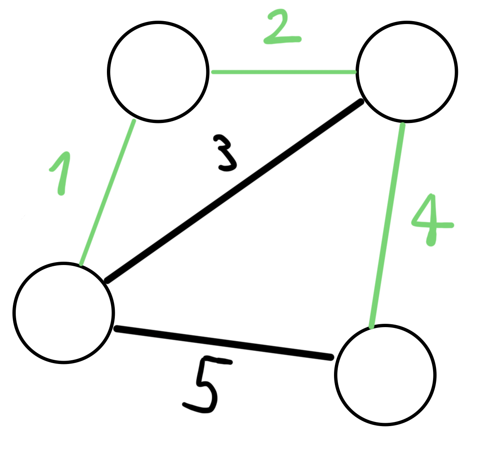

---
hide:
  - toc
---

# 7 - Mst 😭

=== "Zadatak"
	
	| Vremensko ograničenje | Memorijsko ograničenje |
	|:-:|:-:|
	| 1000ms | 256MB |
	
	Godina je 4096. i upravo se u Bajtgradu (glavni grad planete Sendboks) dogodila intergalaktička izložba tehnoloških dostignuća. Tu je Amazon predstavio najnoviju verziju svog sistema veštačke generalne inteligencije Aleksa. Jedna od mnogobrojnih mogućnosti novog sistema je da rešava saobraćajne probleme.
	
	<br>
	
	Aleksina prva ideja je bila da skroz izmeni saobraćajnu mrežu Bajtgrada. Ona je odlučila da za početak sve trenutne ulice blokira montažnim objektima od javnog značaja u kojima će biti organizovane tribine, bioskop na otvorenom, javne diskusije... Nova mreža će se sastojati od tačno $N$ kružnih tokova koji su povezani sa tačno $M$ ulica. Lokacije kružnih tokova je Aleksa već odredila, međutim ima poteškoća oko izbora ulica između njih, i tu joj je potrebna Vaša pomoć.
	
	<br>
	
	Aleksa je već raspisala tender za materijale za nove ulice i, kako je Sendboks izolovana planeta, samo se jedna firma javila, i to sa sledećom ponudom: Dobićete niz $A$ koji se sastoji od $M$ brojeva i putevi koje izgradite će imati kvalitet kaldrme (veći broj znači veći kvalitet) isključivo iz tog niza, bez ponavljanja. Kako je Sendboks daleka planeta, ona nije ništa nalik svetu koji mi poznajemo i za izgradnju puta između bilo koja dva kružna toka je potrebna ista količina materijala, tako da put bilo kog kvaliteta možete da izaberete da izgradite između bilo koja dva kružna toka.
	
	<br>
	
	Puteve moramo da izgradimo tako da može da se dođe od bilo kog kružnog toga do bilo kog drugog kružnog toka, da ne postoji više puteva između dva ista kružna toka, i poznato je da će od izgrađenih puteva, stanovnici Bajtgrada izabrati za kretanje samo deo (podskup) njih ti to na sledeći način:
	
	1. unutar izabranog dela puteva (bez korišćenja ostalih puteva) mora da može da se dođe od bilo kog kružnog toga do bilo kog drugog kružnog toka
	2. ne postoji drugi deo puteva takav da je njegov zbir kvaliteta kaldrme manji od izabranog
	
	<br>
	
	Aleksa veruje da ako je stanovnicima teže da se kreću kroz grad da će biti manje gužve, stoga želi da mi izaberemo $M$ puteva i dodelimo im kvalitete kaldrma iz $A$ tako da deo puteva koji stanovnici budu izabrali za kretanje ima što veći zbir kvaliteta kaldrma (budu što gori za kretanje) i ispišemo samo taj zbir.
	
	<br>
	
	Formalno: Date su težine $M$ grana i treba ispisati najveću težinu [najmanjeg razapinjućeg stabla](https://sr.wikipedia.org/wiki/%D0%A0%D0%B0%D0%B7%D0%B0%D0%BF%D0%B8%D1%9A%D1%83%D1%9B%D0%B5_%D1%81%D1%82%D0%B0%D0%B1%D0%BB%D0%BE_%D0%BC%D0%B8%D0%BD%D0%B8%D0%BC%D0%B0%D0%BB%D0%BD%D0%BE%D0%B3_%D1%81%D1%82%D0%B5%D0%BF%D0%B5%D0%BD%D0%B0) [povezanog prostog grafa](https://sh.wikipedia.org/wiki/Teorija_grafova) sa $N$ čvorova i $M$ grana datih težina.
	
	## Opis ulaza
	
	<br>
	
	U prvoj liniji standardnog ulaza nalaze se brojevi $N$ i $M$ koji redom predstavljaju broj kružnih tokova i broj puteva koji treba izgraditi. U drugoj, i poslednjoj, liniji se nalazi $M$ brojeva, koji predstavljaju kvalitete kaldrme $M$ puteva koje treba izgraditi.
	
	<br>
	
	## Opis izlaza
	
	<br>
	
	Na prvu i jedinu liniju standardnog izlaza ispisati jedan broj koji predstavlja najveći mogući zbir kvaliteta kaldrme na delu puteva koji izaberu stanovnici kada taktički izaberemo kako ćemo izgraditi puteve.
	
	<br>
	
	## Primer 1
	
	<br>
	
	### Ulaz
	
	<br>
	
	```
	4 5
	1 2 3 4 5
	```
	
	<br>
	
	### Izlaz
	
	<br>
	
	```
	7
	```
	
	<br>
	
	### Objašnjenje primera
	
	<br>
	
	Imamo 4 kružna toka i gradimo 5 puteva. Ako izgradimo puteve kao na slici, stanovnici će za kretanje izabrati puteve sa kvalitetom kaldrme $1$, $2$ i $4$, čiji je zbir $7$. Može se dokazati da je nemoguće napraviti veći zbir, pa je rešenje $7$.
	


	


	
	<br>
	
	## Ograničenja
	
	<br>
	
	* $1 \leq N-1 \leq M \leq 200\,000$
	* $1 \leq A_i \leq 10^9$
	* $M \leq \frac{N\cdot \left(N-1\right)}{2}$
	
	<br>
	
	Test primeri su podeljeni u četiri disjunktne grupe:
	* U primerima vrednim 10 poena: $M=N-1$
	* U primerima vrednim 10 poena: $M=N$
	* U primerima vrednim 20 poena: $M=N+9$
	* U primerima vrednim 60 poena: nema dodatnih ograničenja
	
=== "Rešenje"
	
	| Autor | Tekst i test primeri | Analiza rešenja | Testiranje |
	|:-:|:-:|:-:|:-:|
	| Pavle Martinović | Filip Bojković | Filip Bojković | Anja Dožić |
	
	Za početak ćemo malo demistifikovati tekst zadatka. Posmatrajmo kružne tokove kao čvorove neusmerenog [grafa](https://sr.wikipedia.org/wiki/%D0%93%D1%80%D0%B0%D1%84), a ulice koje mi gradimo kao grane tog grafa. Skup ulica koji će stanovnici izabrati za kretanje je [najmanje razapinjuće stablo](https://sr.wikipedia.org/sr-ec/%D0%A0%D0%B0%D0%B7%D0%B0%D0%BF%D0%B8%D1%9A%D1%83%D1%9B%D0%B5_%D1%81%D1%82%D0%B0%D0%B1%D0%BB%D0%BE_%D0%BC%D0%B8%D0%BD%D0%B8%D0%BC%D0%B0%D0%BB%D0%BD%D0%BE%D0%B3_%D1%81%D1%82%D0%B5%D0%BF%D0%B5%D0%BD%D0%B0) tog grafa. Graf koji stvorimo pravljenjem ulica treba da bude prost (da ne postoji više grana između ista dva čvora i da ne postoje grane koje povezuju neki čvor sa njim samim), povezan (da putevima može da se stigne od svakog čvora do svakog drugog čvora). Treba ispisati **najveću** moguću težinu (zbir težina grana) najmanjeg razapinjućeg stabla nekog grafa koji možemo da napravimo. Svako naše pravljenje puteva odgovara nekom grafu i on ima najmanje razapinjuće stablo. Potrebno je naći **najveću** vrednost za bilo koje naše pravljenje puteva. 
	
	## M = N-1
	
	Jedini način da povežemo graf jeste da izgradimo [stablo](https://sr.wikipedia.org/wiki/%D0%A1%D1%82%D0%B0%D0%B1%D0%BB%D0%BE_(%D1%82%D0%B5%D0%BE%D1%80%D0%B8%D1%98%D0%B0_%D0%B3%D1%80%D0%B0%D1%84%D0%BE%D0%B2%D0%B0)) i tada je rešenje samo zbir težina svih datih grana.
	
	```c++
	int n,m; cin>>n>>m;
	vector<int> a(m);
	for(int i=0;i<m;i++) cin>>a[i];
	
	cout<<accumulate(a.begin(),a.end(),0ll); // zbir tezina
	```
	
	## M = N
	
	Povezan graf sa istim brojem čvorova i grana izgleda kao jedan ciklus i nula ili više stabala povezanih za taj ciklus. Najmanje razapinjuće stablo će sadržati sve grane tih povezanih stabala i sve osim jedne grane ciklusa. Kako mi želimo da ono ima što veću težinu želimo da je ta grana koja se ne nalazi u najmanjem razapinjućem stablu što manje težine. Kako stanovnici biraju **najmanje** razapinjuće stablo, tako neće uzeti onu granu najveće težine koja se nalazi u ciklusu. Mi ćemo ih naterati da ne mogu da izbace mnogo veliku granu tako što ćemo napraviti da je ciklus što manji, i napravljeg od što manjih grana. Najmanji ciklus je dužine $3$ i treba da ga sastavimo od $3$ grane najmanje težine.
	
	```c++
	int n,m; cin>>n>>m;
	vector<int> a(m);
	for(int i=0;i<m;i++) cin>>a[i];
	
	if(m==n-1){
	  cout<<accumulate(a.begin(),a.end(),0ll); // zbir tezina
	}else{
	  sort(a.begin(),a.end());
	  long long zbir=0;
	  for(int i=0;i<m;i++){
	    if(i==2) continue; //zbir svih grana osim trece
	    zbir+=a[i];
	  }
	  cout<<zbir;
	}
	```
	
	## (NTOR) Najinteresantiji trenutak ovog rešenja
	
	Posmatrajmo [kruskalov algoritam](https://sr.wikipedia.org/wiki/%D0%9A%D1%80%D1%83%D1%81%D0%BA%D0%B0%D0%BB%D0%BE%D0%B2_%D0%B0%D0%BB%D0%B3%D0%BE%D1%80%D0%B8%D1%82%D0%B0%D0%BC): stanovnici će u svakom koraku birati granu najmanje težine takvu da se ne pravi ciklus, a mi želimo tako da napravimo graf da oni biraju što manje grana male težine. Nakon prve 2 grane možemo da ih ”nateramo” da ne uzmu jednu granu (pravljenjem ciklus), nakon prve 3 uzete grane možemo da ih ”nateramo” da ne uzmu 2 grane, nakon 4 uzete grane možemo 5 itd. Ovo radimo tako što pravimo [kompletan graf](https://sr.wikipedia.org/sr-ec/%D0%9A%D0%BE%D0%BC%D0%BF%D0%BB%D0%B5%D1%82%D0%B0%D0%BD_%D0%B3%D1%80%D0%B0%D1%84) sa trenutnim čvorovima dokle god možemo, kada više ne možemo smo primorani da dodamo novi čvor i samim tim i granu koja mora da bude uzeta.
	
	## Rešenje za sve poene
	
	Potrebno je samo iskoristiti ”NTOR” i paziti da ceo graf bude povezan, a ne i da povežemo najmanji broj čvorova kao što radi direktna implementiacija ”NTOR-a”.
	
	```c++
	  int n,m; cin>>n>>m;
	  vector<int> a(m);
	  for(int i=0;i<m;i++) cin>>a[i];
	
	  sort(a.begin(),a.end());
	  long long zbir = accumulate(a.begin(),a.end(),0ll);
	  int visak = m-n+1; // koliko grana treba preskociti a da graf ostane povezan
	  
	  int cvor = 0;
	  int tren = 0; // broj grana koji trenutno mozemo da preskocimo
	  for(int i=0;i<m;i++){
	      if(tren==0){
	          tren=cvor;
	          cvor++;
	          continue;
	      }
	      if(!visak) break;
	      zbir -= a[i];
	      tren--;
	      visak--;
	      
	  }
	  cout<<zbir;
	```
	
	## M = N+9
	
	Ovaj podzadatak je tu da se dobiju neki poeni za ručnu implementaciju prvih par koraka algoritma za sve poene. ($M-\left(N-1\right) = 10 = 1+2+3+4$)
	
	``` cpp title="07_mst.cpp" linenums="1"
	#include<bits/stdc++.h>
	
	using namespace std;
	
	int main(){
	    int n,m; cin>>n>>m;
	    vector<int> a(m);
	    for(int i=0;i<m;i++) cin>>a[i];
	    sort(a.begin(),a.end());
	    
	    long long res = accumulate(a.begin(),a.end(),0ll);
	    int visak = m-n+1;
	    
	    int cvor = 0;
	    int tren = 0;
	    for(int i=0;i<m;i++){
	        if(tren==0){
	            tren=cvor;
	            cvor++;
	            continue;
	        }
	        if(!visak) break;
	        res -= a[i];
	        tren--;
	        visak--;
	        
	    }
	    cout<<res;
	    return 0;
	}

	```
